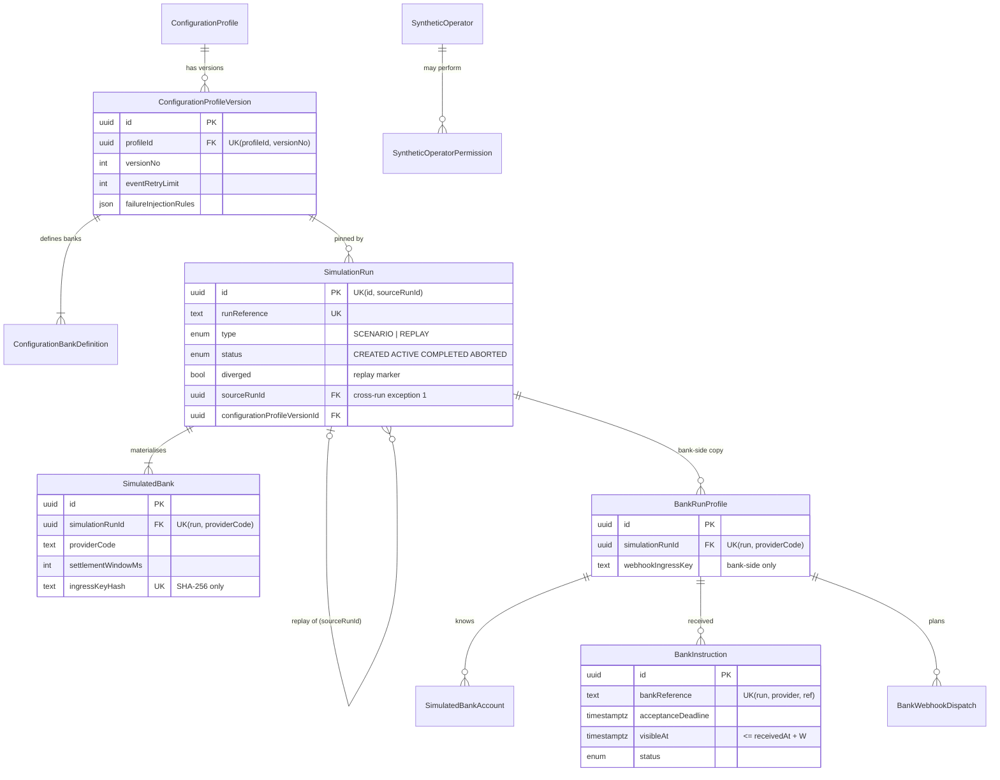
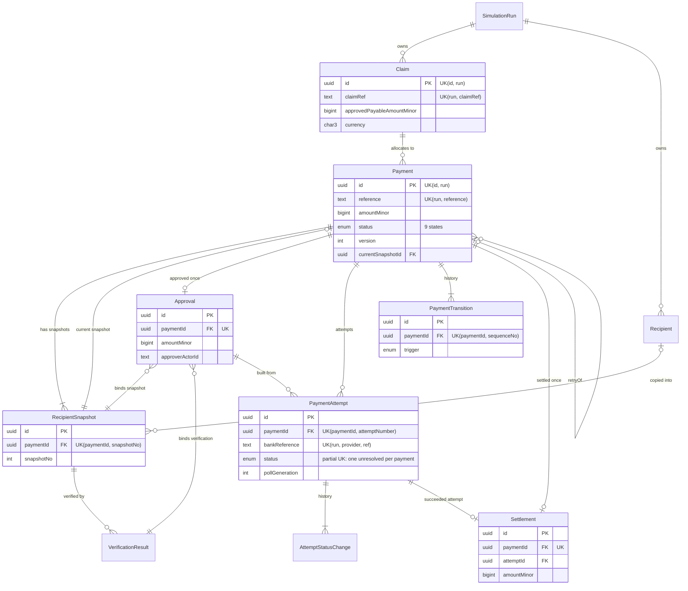
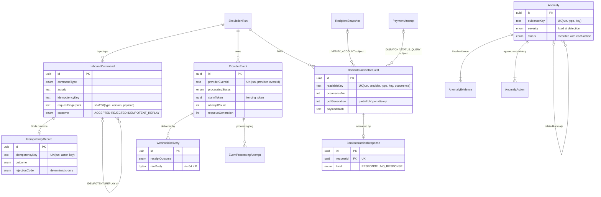
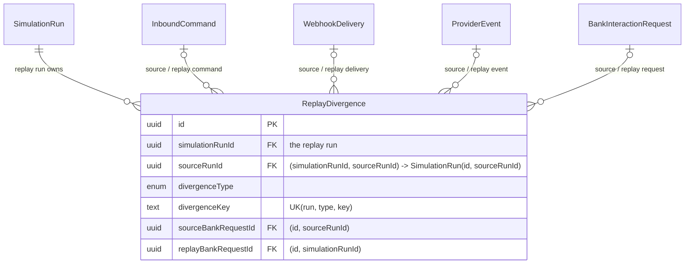

# PaySim Entity Relationship Diagram

> **Status: matches `prisma/schema.prisma` (Phase 3).** The schema is too large for one
> readable picture, so it is split into four diagrams that share entities.
>
> **Notation:**
>
> - `PK` = primary key, `FK` = foreign key, `UK` = part of a unique constraint.
> - Every run-owned entity also has `simulationRunId`. Its references to other run-owned
>   entities are **composite** `(fk, simulationRunId)`, so a reference can never cross runs,
>   except for the two exceptions in §5.
> - Full field lists are in [`data-model.md`](data-model.md). Enforcement is described in
>   [`database-design.md`](database-design.md).

## 1. Namespaces and ownership

```text
simconfig (global catalogue, read-only to apps)        paysim (PaySim side)                      simbank (bank side)
──────────────────────────────────────────────         ─────────────────────────────────         ───────────────────────────
ConfigurationProfile                                    SimulationRun ◄── owns everything ──────► BankRunProfile
  └─ ConfigurationProfileVersion ◄── pinned by ───────    ├─ SimulatedBank                          ├─ SimulatedBankAccount
       └─ ConfigurationBankDefinition                     ├─ Claim, Recipient, Payment …            ├─ BankInstruction
SyntheticOperator                                         ├─ commands, events, bank interactions    └─ BankWebhookDispatch
  └─ SyntheticOperatorPermission                          └─ anomalies, replay divergences
```

- **Global records** (`simconfig`) belong to no run and are never modified once published.
- **Run-owned records** (`paysim`, `simbank`) all carry a non-null `simulationRunId`.
- **The bank side** (`simbank`) references only the run itself. It has no foreign keys into
  PaySim's payment records, and PaySim's database role cannot read it.

## 2. Runs, configuration and the bank side



## 3. Claims, recipients and payments



## 4. Commands, events, bank interactions and anomalies



## 5. Replay divergences: the two cross-run exceptions



Only two references may cross runs:

1. **`SimulationRun.sourceRunId`.** A replay points at its completed source run.
2. **`ReplayDivergence` source references.** Each source reference is composite with
   `sourceRunId`, and the pair `(simulationRunId, sourceRunId)` must match the replay run's
   own `(id, sourceRunId)`. So a divergence can only cite evidence from **its own** source
   run, never from an unrelated run. The test suite proves this (`replay.db-spec.ts`).

## 6. Cardinalities in plain language

- **Runs and banks.** A configuration version can be pinned by many runs; each run pins
  exactly one. A run has at least one simulated bank before it can become active. Its bank
  settings are copies of the pinned version and never change afterwards.
- **Claims and payments.** A claim can fund many payments. The payments that are still live
  can never add up to more than the claim's approved amount.
- **Snapshots.** A payment has one or more recipient snapshots (one per correction) and
  points at exactly one current snapshot. A snapshot belongs to one payment.
- **Approval.** A payment has at most one approval. It names the exact snapshot,
  verification and amount.
- **Attempts.** A payment has zero or more attempts, at most one of them unresolved. Every
  attempt has a status history that starts with `PENDING`.
- **Transitions and settlement.** A payment has one transition per status change, starting
  with its creation, and at most one settlement, tied to the attempt that succeeded.
- **Commands.** A command may bind at most one idempotency record. A replayed request points
  at the command whose answer it repeats.
- **Provider events.** A provider event has one or more deliveries (receipt) and zero or more
  processing attempts. Its row holds only the current claim.
- **Bank interactions.** A bank request has zero or one response. Zero means "unanswered",
  which is distinct from a `NO_RESPONSE` timeout. Each attempt has at most one `DISPATCH`
  request, and at most one status query per poll generation.
- **Anomalies.** An anomaly has at least one evidence row (fixed at creation) and at least one
  action (`OPENED` first). Its stored status always matches its latest action.
