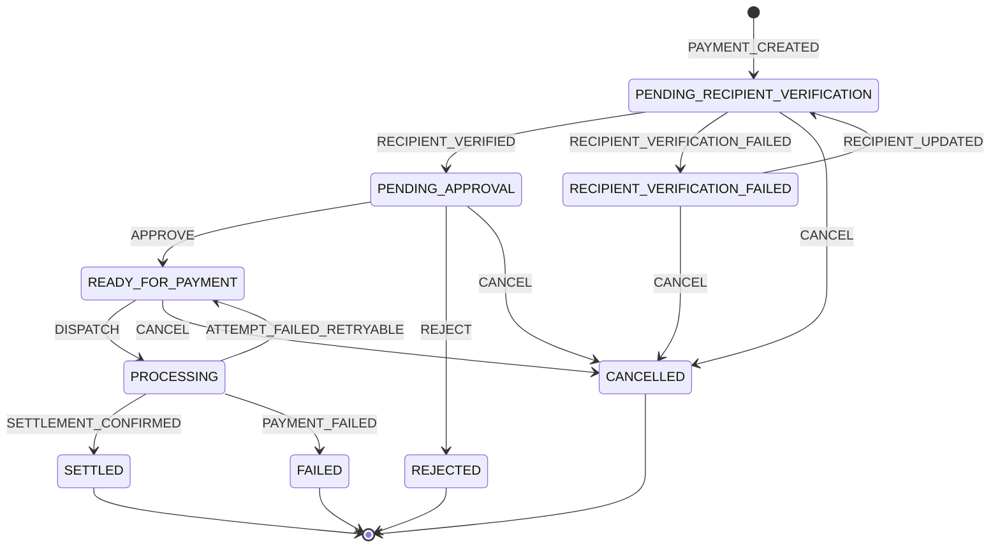
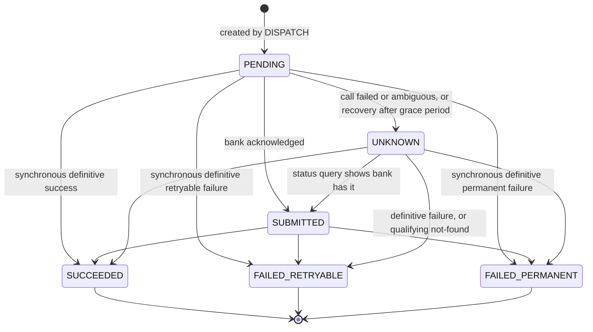

# Payment Lifecycle — CLAIM_PAYOUT

> **Status: approved (revision 5). Phase 3 implements the data model and database
> enforcement; payment-processing services are not implemented yet.**
> This document defines the payment states, permitted transitions, attempt lifecycle,
> recipient verification, claim allocation, webhook handling, recorded bank interactions,
> replay inputs, anomaly resolution, failure and retry behaviour, and financial invariants
> for PaySim's first workflow: the insurance claim payout.
>
> It is a design, not a database schema. The concrete data model is in
> [`data-model.md`](data-model.md), [`erd.md`](erd.md) and
> [`database-design.md`](database-design.md); transaction boundaries are in
> [`transaction-design.md`](transaction-design.md).
>
> Revision 5: 2026-10-30. Applies the approved data-model decisions (amendments L1–L11)
> and four corrections: the idempotency fingerprint, unrecorded in-progress requests,
> synthetic operator identity, and status-polling claims. A changelog is in §17.

**How to read this document**

- §1 explains every concept used later, first technically and then in plain English.
  If terms like _state machine_, _idempotency_ or _webhook_ are new to you, start there.
- §2 lists every decision and its status: confirmed, approved, or new in this revision
  (awaiting review).
- §3–§9 contain the design: states, transitions, attempts (including the simulated bank's
  queryability guarantee), verification, claim allocation, webhooks, recorded bank
  interactions, and replay inputs.
- §10–§11 cover failure handling, anomaly resolution and financial invariants.
- §12 walks through a complete synthetic ₦2,500,000 claim payout.
- §14 lists the questions that remain open. §15 is the consistency review.

---

## 1. Concepts primer

Each concept has two explanations: **(A)** the technical one and **(B)** a plain-English
one with an everyday example.

### 1.1 State and state machine

**A.** A _state_ is the single, named condition a payment is in at any moment
(e.g. `PROCESSING`). A _state machine_ is the complete set of states plus the rules for
moving between them. Given the current state and an incoming trigger, the state machine
returns either the next state or a rejection. In PaySim it lives in
`@paysim/state-machine` as pure code: no database, no clock, no network. That makes
every rule exhaustively testable and deterministic.

**B.** Think of a parcel-tracking page: _Order placed → Packed → Out for delivery →
Delivered_. A parcel is only ever in one of those steps, and it can't jump from
_Order placed_ straight to _Delivered_. The state machine is the rulebook that says
which jumps are legal. If someone tries an illegal jump, the rulebook says "no".

### 1.2 Transition, trigger and guard

**A.** A _transition_ is a move from one state to another (`PENDING_APPROVAL →
READY_FOR_PAYMENT`). A _trigger_ is what requests the move: a user command (`APPROVE`)
or a provider outcome (`SETTLEMENT_CONFIRMED`). A _guard_ is a condition that must be
true for the transition to be accepted (e.g. "approver is not the payment's creator").
Allowed transitions are listed explicitly; anything not listed is forbidden.

**B.** A transition is "moving to the next step". The trigger is the reason ("the
manager clicked Approve"). The guard is the check before the move is allowed ("the
manager is not approving their own request"). If the check fails, the move doesn't happen.

### 1.3 Terminal state

**A.** A _terminal state_ has no outbound transitions. Once a payment reaches one
(`SETTLED`, `FAILED`, `CANCELLED`, `REJECTED`), its status never changes again. Any
correction is a **new**, linked record, such as a refund, a return or a re-issued payout.
It is never an edit to the original.

**B.** Once a cheque is cashed, you can't "un-cash" it by editing the bank statement.
If something was wrong, the bank makes a new, separate entry that reverses it. The
original entry stays exactly as it happened.

### 1.4 Current status plus append-only history

**A.** Each payment stores its **current status** for fast reads. It also stores an
**append-only transition history**: one immutable row per accepted transition, written
in the same database transaction as the status change. Rows are only inserted, never
updated or deleted. This is _not_ event sourcing (C2). The status column is
authoritative for reads; the history is the audit trail and must always agree with it.

**B.** A hospital patient has a whiteboard by the bed showing their current condition
(the status). There is also a logbook where every change is written down and never
erased (the history). You read the whiteboard for a quick answer and the logbook to know
exactly what happened, when, and who did it.

### 1.5 Webhook

**A.** A _webhook_ is an HTTP request **from** an external system **to** PaySim,
announcing that something happened (e.g. "transfer settled"). The provider decides when
to send it. Providers deliver _at least once_: if they don't receive a timely `2xx`
response, they resend. So the same webhook can arrive more than once, late, or out of
order relative to other webhooks.

**B.** Instead of you phoning the bank every minute to ask "has it gone through yet?",
the bank promises to text you when it happens. But texts can be delayed, can arrive
twice, and can arrive in the wrong order. Your system must cope with all three.

### 1.6 Idempotency (API requests)

**A.** An operation is _idempotent_ if performing it many times has the same effect as
performing it once. Clients send an `Idempotency-Key` with each state-changing request.
PaySim stores the key, a **request fingerprint** and the final response. The fingerprint is a
hash of the command type, the API version and the canonical request payload. A body hash alone
is not enough, because the same body sent to a different operation is a different request. A
repeat with the same key and fingerprint returns the stored response without re-executing. The
same key with a different fingerprint is rejected.

**B.** A lift button: pressing it five times doesn't call five lifts. Or think of
a cashier who stamps your receipt "PAID". If you hand the same receipt over again, they
see the stamp and say "already done" instead of charging you twice.

### 1.7 Provider events vs. webhook deliveries

**A.** These are two different things:

- A **provider event** is the logical fact the provider is reporting ("transfer X
  settled"). Its identity is `(simulationRunId, provider, providerEventId)`, and it is
  recorded exactly once.
- A **webhook delivery** is one HTTP request that tries to deliver an event. One event
  can have many deliveries (the provider retries), and every delivery gets its own
  record.

A _redelivery_ (same event identity arriving again) creates a new delivery record but
never reprocesses the event. A _semantic duplicate_ (a **new** event identity that
repeats an outcome already applied) is a separate event, processed normally, and the
state machine classifies it `NO_OP`. API idempotency (§1.6) is separate again: it
protects against _our clients_ retrying, not the provider (C5).

**B.** A courier tries to deliver the same parcel three times before you answer the
door. That's one parcel (the event) and three delivery attempts (deliveries). Your
doorbell log records all three knocks, but you only open the parcel once. If the shop
mistakenly sends a _second_ parcel containing the same item, that's a different parcel.
You open it, see you already have the item, and put it aside.

### 1.8 Delayed and out-of-order events

**A.** A _delayed_ event arrives after PaySim has already learned the same outcome
another way (e.g. via a status query). An _out-of-order_ event arrives after a later
event, e.g. "processing" after "settled". PaySim never discards these. Each is stored and
classified: applied, no-op, or rejected with a reason (C7).

**B.** A "your parcel is out for delivery" text that arrives after the parcel is already
on your doorstep. You don't put the parcel back in the van. You note the text arrived
late and ignore what it says.

### 1.9 Payment vs. payment attempt

**A.** A _payment_ is the business intention: pay ₦X to recipient Y for claim Z. A
_payment attempt_ is one concrete instruction sent to the bank, with its own unique bank
reference. Attempts have their own lifecycle (§5). Three of their statuses, `PENDING`,
`SUBMITTED` and `UNKNOWN`, are **unresolved**: the money might still move. A payment
may have several attempts over its life, but **at most one unresolved attempt at any
time**, and a new attempt may only follow a definitive failure.

**B.** You want to send a friend money (the payment). Your first transfer bounces
because the bank's system is down (attempt 1 failed). You try again an hour later and
it works (attempt 2 succeeded). Your friend was paid once. You made two attempts. You'd
never start attempt 2 while you were still unsure whether attempt 1 went through.

### 1.10 Unknown outcome

**A.** When PaySim's call to the bank times out, or PaySim crashes mid-call, the
instruction may or may not have been received and executed. The attempt is `UNKNOWN`,
which is distinct from failed. An unknown outcome is resolved by querying the bank's
transaction status using the attempt's reference, or by a webhook. **It is never
resolved by assuming failure and resending.**

**B.** You post a cheque and never hear back. That doesn't mean it wasn't cashed. Before
writing a second cheque, you phone the bank and ask whether the first one was paid.
Otherwise your friend might get paid twice.

### 1.11 Financial invariant

**A.** An _invariant_ is a rule that must hold at all times, in every state, regardless of
failures, retries or concurrency. Financial invariants are enforced in layers:

1. the state machine (logic);
2. database constraints (unique indexes, checks, locks), which hold even if application
   code has a bug;
3. tests that try to break them.

**B.** "The money in the till must equal the day's sales minus change given." It doesn't
matter how busy the shop was or who worked the till: if that rule is ever false,
something has gone wrong and must be investigated.

### 1.12 Minor units

**A.** Amounts are stored as integers in the currency's smallest unit (kobo for NGN,
cents for USD), as `BigInt`, alongside an ISO 4217 currency code. The number of minor
units per major unit (the _exponent_) depends on the currency: NGN has 2, JPY has 0.
JavaScript floats can't represent many decimal values exactly
(`0.1 + 0.2 !== 0.3`), so they are never used for money. In the API, amounts are strings
of digits (e.g. `"250000000"`), because JSON numbers lose precision above 2⁵³.

**B.** ₦2,500,000.00 is stored as 250,000,000 kobo, a whole number, so no rounding can
ever creep in. It's like counting coins instead of estimating the weight of a bag of
coins.

### 1.13 Simulation runs and replay isolation

**A.** Every simulation-owned record belongs to a **simulation run**, identified by a
non-null `simulationRunId`. A _replay_ is a new run that re-feeds a source run's
recorded inputs (§9) into fresh, run-scoped state. The inputs are:

- every inbound command;
- every webhook delivery;
- every recorded response from the simulated bank (consumed from the recording, never
  regenerated).

Records of the source run are read-only to the replay (C6). The replay reuses the source
run's readable payment and attempt references, but its internal UUIDs are new.
Uniqueness constraints on external or human-readable identifiers include
`simulationRunId`, so the same reference can exist once per run without colliding.

**B.** A flight simulator re-flies a recorded flight to study it. It replays the pilot's
recorded inputs **and the recorded weather**, rather than inventing new weather, on a
fresh simulated aircraft that carries the same flight number. Crashing the simulator
doesn't damage the real aircraft, and the real flight's logbook is never altered.

### 1.14 Concurrency control: optimistic and pessimistic

**A.** Two operations can try to change the same data at the same moment. PaySim uses
two techniques, each where it fits:

- **Optimistic concurrency** for a single payment. Each payment carries a `version`; a
  transition updates `WHERE id = ? AND version = ?` and increments it. The loser of a
  race gets a conflict and re-reads. This suits payments because collisions are rare.
- **Pessimistic locking** for claim allocation. Before checking how much of a claim is
  still payable, a transaction takes a row lock on the claim (`SELECT … FOR UPDATE`).
  Competing transactions wait their turn. This is needed because the check spans
  _many_ payment rows (a sum), and a version on one row can't protect a sum (§7).

**B.** Optimistic is a shared document that refuses your save with "this changed since
you opened it, please reload". Pessimistic is a single key to the petty-cash box:
whoever holds the key counts the cash and takes money out, and everyone else waits
until the key is returned. So two people can never both see "₦2.5m left" and both take it.

### 1.15 Recipient snapshot and versioned verification

**A.** A **recipient** is a reusable record (e.g. a policyholder's payee profile). A
payment never points at the live, editable recipient. Instead it holds an **immutable
snapshot** of the recipient's details (bank, account number, account name) taken when
the payment is created. Correcting the details creates a **new snapshot**; old snapshots
are kept. Every verification result names the exact snapshot it verified, and every
approval names the exact snapshot, verification and amount it approved. A verification
of an old snapshot cannot qualify the payment.

**B.** A photocopy of a signed form. If someone corrects the original form, the
signature on the old photocopy doesn't carry over to the new version. The new version
has to be checked and signed again.

### 1.16 Inbound command record

**A.** Every state-changing request that reaches PaySim's command handling is recorded as
an **inbound command**, whatever its outcome: accepted, rejected (with reason), or
answered from the idempotency store. Accepted commands are recorded in the same
transaction as their effect. Rejected commands are recorded on their own and **never**
create payment transitions. Together with provider events and deliveries, these records
are the audit trail of everything PaySim was asked to do, and the input tape for replays.

**B.** A receptionist's visitor book records everyone who came to the front desk: those
who got in, those turned away (and why), and those who came back a second time with the
same appointment. The book doesn't change who's in the building. It records who asked.

### 1.17 Anomaly and anomaly resolution

**A.** An **anomaly** is a recorded contradiction or integrity problem that the system
cannot safely settle by itself. Examples: a bank reporting success for an attempt it
had already declared failed, or a webhook whose amount doesn't match the attempt.

- An anomaly links to its **evidence** (events, deliveries, bank interactions,
  attempts), which is never altered.
- **Critical** anomalies may have financial impact. While one is open against a
  payment, that payment cannot be dispatched (D15). Only an authorised person can
  resolve one.
- Resolving, and reopening, are append-only actions, each with an actor, a cause and a
  time. Resolution never edits the payment's or the attempt's history (§10.4).

**B.** A shop's "incident book". When the till and the receipts disagree, the manager
writes an incident, staples the receipts to it, and stops using that till. Closing the
incident means writing _who_ checked it, _what_ they found and _when_. They never
rewrite the receipts. If new facts turn up, the incident can be reopened, and that is
written down too.

### 1.18 Recorded bank interaction

**A.** Every request PaySim sends to a simulated bank (account verification, transfer
dispatch, status query) is recorded as an insert-only **request record**. The bank's
answer is recorded as a separate insert-only **response record** that points back to the
request. An observed timeout is recorded as a response of kind "no response". If PaySim
crashes before observing anything, the request simply has no response record. Nothing
is ever written back onto the request. These records are evidence for every attempt and
verification outcome, and they are the bank's side of the replay tape (R2).

**B.** A call-centre recording. Each call to the bank is recorded, including the ones
where the line went dead. Later you can replay exactly what the bank said, instead of
guessing what it _would_ say today.

---

## 2. Decisions

### 2.1 Confirmed architectural decisions

| #   | Decision                                                                                                                                   |
| --- | ------------------------------------------------------------------------------------------------------------------------------------------ |
| C1  | Money is `BigInt` minor units plus an ISO 4217 currency code. API monetary values are strings.                                             |
| C2  | Current status plus append-only transition and event history. **Not** full event sourcing.                                                 |
| C3  | One `Payment` entity with a payment type. Refunds are separate, linked payment records.                                                    |
| C4  | Initial MVP workflow: `CLAIM_PAYOUT`.                                                                                                      |
| C5  | API request idempotency and provider event deduplication are handled separately.                                                           |
| C6  | Replays run in isolated simulation runs and cannot modify original payment records.                                                        |
| C7  | Out-of-order events are preserved; if their transition is invalid, the rejection is recorded.                                              |
| C8  | IDs are UUIDv7 internally, with readable references externally (e.g. `PAY-2026-000042`).                                                   |
| C9  | Event publication uses database transactions initially; a transactional outbox will be evaluated when asynchronous delivery is introduced. |

### 2.2 Design rules

Status key:

- **Approved:** explicitly approved or specified in a review (Phase 2A, the revision-2
  to revision-4 reviews, or the Phase 3 data-model decision pass).
- **New in rev 3 / rev 4:** detail introduced by that revision to make an approved
  requirement precise and safe. Awaiting review.

| #   | Rule                                                                                                                                                                                                                                                                                                                                                            | Status                                                       | Section |
| --- | --------------------------------------------------------------------------------------------------------------------------------------------------------------------------------------------------------------------------------------------------------------------------------------------------------------------------------------------------------------- | ------------------------------------------------------------ | ------- |
| D1  | Nine-state lifecycle (drop `CREATED`/`APPROVED`, rename `RECIPIENT_SETUP`, add `RECIPIENT_VERIFICATION_FAILED` and `REJECTED`).                                                                                                                                                                                                                                 | Approved                                                     | §3      |
| D2  | Verify the recipient before approval.                                                                                                                                                                                                                                                                                                                           | Approved                                                     | §3.2    |
| D3  | Six attempt statuses. `PENDING`, `SUBMITTED` and `UNKNOWN` are unresolved, and at most one unresolved attempt is allowed per payment.                                                                                                                                                                                                                           | Approved                                                     | §5      |
| D4  | A retryable attempt failure returns the payment to `READY_FOR_PAYMENT`. Three attempts, with 1 / 5 / 30-minute back-off, configurable per simulated bank.                                                                                                                                                                                                       | Approved                                                     | §5.6    |
| D5  | `FAILED` is terminal. A manual retry after failure creates a new, linked payment.                                                                                                                                                                                                                                                                               | Approved                                                     | §5.6    |
| D6  | Cancellation only before dispatch, never during `PROCESSING`.                                                                                                                                                                                                                                                                                                   | Approved                                                     | §4      |
| D7  | Provider events and webhook deliveries are separate. `2xx` is returned only after durable receipt; unprocessed events are recoverable.                                                                                                                                                                                                                          | Approved                                                     | §8      |
| D8  | Approver must differ from the payment's creator.                                                                                                                                                                                                                                                                                                                | Approved                                                     | §4.1    |
| D9  | Per-payment transitions are serialised with optimistic concurrency (`version`).                                                                                                                                                                                                                                                                                 | Approved                                                     | §1.14   |
| D10 | Exactly one settlement record per payment (database unique constraint). No ledger in MVP.                                                                                                                                                                                                                                                                       | Approved (Q14)                                               | §11     |
| D11 | Claim allocation: every allocation-affecting operation takes the claim-row lock first. `RECIPIENT_VERIFICATION_FAILED` keeps its reservation.                                                                                                                                                                                                                   | Approved                                                     | §7      |
| D12 | Verification and approval are bound to an exact recipient snapshot (and, for approval, an exact amount).                                                                                                                                                                                                                                                        | Approved                                                     | §6      |
| D13 | All inbound commands are persisted, including rejected ones and idempotent replays; provider events and deliveries are persisted too.                                                                                                                                                                                                                           | Approved                                                     | §9      |
| D14 | `simulationRunId` is **non-null** on all simulation-owned records. Non-replay activity also runs inside a run.                                                                                                                                                                                                                                                  | Approved                                                     | §9.3    |
| D15 | An open critical anomaly on a payment blocks `DISPATCH`. Anomalies are guards, not payment states (R5).                                                                                                                                                                                                                                                         | Approved                                                     | §10.4   |
| D16 | Recipient names match by deterministic, order-independent, exact token-multiset comparison. No fuzzy or partial matching (R1).                                                                                                                                                                                                                                  | Approved                                                     | §6.4    |
| D17 | Every simulated bank interaction (verification, dispatch, status query) is recorded with its response. Replays consume the recordings (R2).                                                                                                                                                                                                                     | Approved                                                     | §9.4    |
| D18 | Replay runs reuse the source run's readable payment and attempt references; internal UUIDs are new (R3).                                                                                                                                                                                                                                                        | Approved                                                     | §9.3    |
| D19 | Recovery is query-only. An unresolved attempt is never resent, even to a bank that declares reference idempotency (R4).                                                                                                                                                                                                                                         | Approved                                                     | §5.5    |
| D20 | Anomaly resolution: evidence is immutable; resolve and reopen are append-only actions with actor, cause and time; critical anomalies need a human.                                                                                                                                                                                                              | Approved (requirement A); details new in rev 3               | §10.4   |
| D21 | Event-processing retries are bounded; exhaustion raises an anomaly and escalates. A `2xx` confirms receipt only.                                                                                                                                                                                                                                                | Approved (requirement B); limits new in rev 3                | §8.5    |
| D22 | Queryability guarantee per simulated bank, plus an **instruction acceptance deadline** on every attempt; both are required before a not-found result can count as definitive.                                                                                                                                                                                   | Approved (requirement C); acceptance deadline new in rev 3   | §5.7    |
| D23 | Opening or reopening a critical anomaly locks the payment row, so it serialises with `DISPATCH`.                                                                                                                                                                                                                                                                | New in rev 3                                                 | §10.4   |
| D24 | Event processing is claimed atomically into a `PROCESSING` state with a lease and fencing token. Attempts are counted at claim time, so a crash still counts.                                                                                                                                                                                                   | Approved (correction 1); lease defaults new in rev 4         | §8.5    |
| D25 | Critical anomalies are **always** resolved by an authorised person. System success (e.g. reprocessing) is evidence only. Attention anomalies may auto-resolve on their stated objective condition.                                                                                                                                                              | Approved (correction 2)                                      | §10.4   |
| D26 | Playback matches by (interaction type, readable key, occurrence), then compares request payload hashes. A mismatch, an unrecorded request or an unused recording is a divergence. A mismatched request never receives the original response.                                                                                                                    | Approved (correction 3); continue-on-divergence new in rev 4 | §9.4    |
| D27 | Bank interaction requests and responses are separate insert-only records. A request record is never updated to attach its response.                                                                                                                                                                                                                             | Approved (correction 4)                                      | §9.4    |
| D28 | Idempotency protocol: a transaction-scoped advisory lock per `(run, actor, key)`. A request that can't take the lock gets `409` and writes nothing. One transaction with a savepoint. Accepted and deterministically rejected outcomes are bound to the key; transient rejections are not. Fingerprint = command type + API version + canonical payload (§9.1). | Approved (DM6, corrected)                                    | §9.1    |
| D29 | Webhook ingress: each run-scoped simulated bank has a cryptographically random ingress key that routes requests. It is stored hashed, never logged, and does not authenticate (signatures still do). Unattributable requests get `404` and a log line only (§8.2).                                                                                              | Approved (DM1, safeguard)                                    | §8.2    |
| D30 | Configuration: global, versioned configuration profiles (bank definitions, processing defaults, failure-injection rules) are pinned by each run, materialised at creation, and frozen once the run is `ACTIVE`.                                                                                                                                                 | Approved (DM2)                                               | §9.3    |
| D31 | Simulated bank boundary: bank-side state lives in a separate PostgreSQL schema, accessed by a separate database role. PaySim learns bank state only through recorded bank interactions and webhooks.                                                                                                                                                            | Approved (DM3, safeguard)                                    | §9.4    |
| D32 | Synthetic operator identity: a development identity mechanism, **not** authentication. A server-side allowlist of seeded synthetic operators and their permitted actions decides authority. Client-supplied identity never grants authority by itself.                                                                                                          | Approved (DM9, corrected)                                    | §9.1    |
| D33 | Status polling uses an explicit, fenced polling-work claim. No transaction or row lock is held during a bank call (§5.8).                                                                                                                                                                                                                                       | Approved (DM11, corrected)                                   | §5.8    |
| D34 | Run lifecycle: `CREATED → ACTIVE → COMPLETED`, or `ABORTED`. `DIVERGED` is a separate replay marker. Replays start only from `COMPLETED` runs. A run completes only when no work is in flight.                                                                                                                                                                  | Approved (DM12)                                              | §9.3    |

**Why D14 is needed.** Q10 was approved as "`simulationRunId` on all simulation-owned
records", but revision 1 suggested `null` could mean "original". In PostgreSQL, `NULL`
values are treated as distinct from each other in a unique constraint. A rule such as
`UNIQUE (simulationRunId, reference)` would therefore **not** stop two "original" payments
from sharing a reference. Making every record belong to a run (original scenario runs
and replay runs alike) closes that gap.

**Why D15 is needed.** If a bank reports success for an attempt it had previously
declared definitively failed, money may have moved twice. Without D15, the payment
could be sitting in `READY_FOR_PAYMENT` and the dispatcher would send another attempt.

**Why D22's acceptance deadline is needed.** A settlement window measured from the moment
of _receipt_ isn't enough on its own. After a timeout we don't know **when** (or whether)
the bank received the instruction: a request delayed in the network could arrive long
after we gave up on it. The acceptance deadline puts an upper bound on the receipt time.
That bound is what lets a not-found result be trusted (§5.7).

**Why D23 is needed.** D15 is checked by T10. If an anomaly could be opened in a
different transaction at the same moment as a dispatch, the dispatch could miss it.
Making both serialise on the payment row closes that race.

### 2.3 Resolved questions

| #   | Decision                                                                                                                    | Where applied |
| --- | --------------------------------------------------------------------------------------------------------------------------- | ------------- |
| Q1  | Revised state set and verify-before-approval ordering approved.                                                             | §3            |
| Q2  | Reusable recipient record plus immutable payment snapshot.                                                                  | §6.1          |
| Q3  | Minimal `Claim` entity with an authoritative approved payable amount.                                                       | §7            |
| Q4  | Normalised exact name match. **Refined by R1** into exact token-multiset matching (D16).                                    | §6.4          |
| Q5  | Expiry enforcement deferred; `verifiedAt` recorded.                                                                         | §6.2          |
| Q6  | Three attempts; 1-, 5- and 30-minute back-off defaults, configurable per simulated bank.                                    | §5.6          |
| Q7  | Configurable settlement window per simulated bank; manual escalation for unresolved attempts.                               | §5.5          |
| Q8  | Separate webhook delivery log.                                                                                              | §8            |
| Q9  | Rejected API commands persisted as audit and input records.                                                                 | §9.1          |
| Q10 | `simulationRunId` on all simulation-owned records, included in relevant uniqueness constraints.                             | §9.3          |
| Q11 | Every inbound command and provider event recorded, including rejected inputs.                                               | §9            |
| Q12 | Per-year PostgreSQL sequence for payment references; attempt references derived from payment reference plus attempt number. | §9.3          |
| Q13 | `SETTLED` stays terminal; future returns become separate linked records.                                                    | §3, §13       |
| Q14 | Settlement record for MVP; double-entry ledger deferred.                                                                    | §11           |
| Q15 | Webhook signatures simulated. Invalid signatures never become provider events.                                              | §8.6          |

### 2.4 Resolved in the revision-2 review

| #   | Decision                                                                                                                                                                          | Where applied     |
| --- | --------------------------------------------------------------------------------------------------------------------------------------------------------------------------------- | ----------------- |
| R1  | Order-independent exact token-multiset name matching. Duplicate tokens preserved; no fuzzy or partial matching; raw names and result kept.                                        | §6.4              |
| R2  | All simulated bank responses (verification, dispatch, status query) are recorded. Replays consume them; nothing is regenerated.                                                   | §9.2, §9.4        |
| R3  | Replays reuse readable payment and attempt references. Internal UUIDs stay distinct; uniqueness stays scoped by run.                                                              | §9.3              |
| R4  | Recovery is query-only. Unresolved attempts are never resent.                                                                                                                     | §5.5              |
| R5  | Critical anomalies stay dispatch guards, not payment states.                                                                                                                      | §10.4             |
| R6  | D5, D6, D8, D9, D14 and D15 approved.                                                                                                                                             | §2.2              |
| R7  | A playback miss or request mismatch answers `NO_RESPONSE` and records a divergence (confirmed).                                                                                   | §9.4              |
| R8  | `RESOLVE_ATTEMPT` may only set `SUCCEEDED` or `FAILED_PERMANENT` (confirmed).                                                                                                     | §10.4             |
| R9  | Revision-3 details approved: acceptance deadline (D22); anomaly severities and resolution types (D20); 5 processing retries (D21); payment-row lock for critical anomalies (D23). | §5.7, §8.5, §10.4 |
| R10 | Revision-4 details approved: 60 s lease; attempts counted at claim time; `LEASE_EXPIRED`; replays continue after a divergence; severity fixed at detection.                       | §8.5, §9.4, §10.4 |

---

## 3. Payment states

### 3.1 Evaluation of the originally proposed states (approved as revised)

| Proposed state      | Outcome                                  | Reasoning                                                                                                                                                                                                                 |
| ------------------- | ---------------------------------------- | ------------------------------------------------------------------------------------------------------------------------------------------------------------------------------------------------------------------------- |
| `CREATED`           | Removed                                  | Amount and currency are immutable from creation (I4), so a newly created payment waits only for recipient verification. A state that is always left immediately adds noise. Creation is recorded as the first transition. |
| `PENDING_APPROVAL`  | Kept                                     | A real wait: finance must release the payment. This is _payment-release approval_, distinct from the claim being approved for payout, which happens in the claims domain beforehand.                                      |
| `APPROVED`          | Merged into `READY_FOR_PAYMENT`          | With verification before approval, an approved payment waits only for dispatch. The approval is recorded as its own record (§6.3) and in the history.                                                                     |
| `RECIPIENT_SETUP`   | Renamed `PENDING_RECIPIENT_VERIFICATION` | Waiting-state names should say what is awaited, not name an activity.                                                                                                                                                     |
| `READY_FOR_PAYMENT` | Kept                                     | Verified, approved, waiting for the dispatcher: the first attempt, or the next attempt after a retryable failure.                                                                                                         |
| `PROCESSING`        | Kept                                     | An attempt is unresolved (`PENDING`, `SUBMITTED` or `UNKNOWN`). Entered **before** the bank call (§5.4).                                                                                                                  |
| `SETTLED`           | Kept, terminal                           | Bank confirmed funds credited.                                                                                                                                                                                            |
| `FAILED`            | Kept, terminal                           | Only after a definitive failure that permits no further automatic attempt. A timeout is never a failure.                                                                                                                  |
| `CANCELLED`         | Kept, terminal                           | Withdrawn by an operator before dispatch.                                                                                                                                                                                 |
| _(added)_           | `RECIPIENT_VERIFICATION_FAILED`          | Verification failed; recoverable by correcting details. Not `FAILED`: no money was attempted.                                                                                                                             |
| _(added)_           | `REJECTED`, terminal                     | Finance declined to release the payment. This is a distinct fact from an operator withdrawing it (`CANCELLED`).                                                                                                           |

### 3.2 Why verify before approval

**A.** If verification came after approval, the approver would sign off on an account that
may not exist or may belong to someone else. A failed verification would then force a
recipient change after approval, invalidating it. Verifying first means the approver
sees the verified account name, and corrections happen before any approval exists.

**B.** You check that the address on a parcel is real before your manager signs the
shipping form, not after. Otherwise the manager has signed for a parcel going nowhere,
and every address fix needs a fresh signature.

### 3.3 State set

| State                            | Meaning                                                                        | Terminal | Reserves claim allocation | Who acts next                  |
| -------------------------------- | ------------------------------------------------------------------------------ | -------- | ------------------------- | ------------------------------ |
| `PENDING_RECIPIENT_VERIFICATION` | Payment recorded; current recipient snapshot awaiting verification.            | No       | Yes                       | Recipient verifier (system)    |
| `RECIPIENT_VERIFICATION_FAILED`  | Current snapshot failed verification; waiting for corrected details or cancel. | No       | **Yes**                   | Operator                       |
| `PENDING_APPROVAL`               | Current snapshot verified; waiting for finance to release.                     | No       | Yes                       | Approver                       |
| `READY_FOR_PAYMENT`              | Approved; no unresolved attempt; waiting for dispatch (first or retry).        | No       | Yes                       | Dispatcher (system)            |
| `PROCESSING`                     | Exactly one unresolved attempt exists.                                         | No       | Yes                       | Bank (webhook) / status poller |
| `SETTLED`                        | Bank confirmed funds credited.                                                 | **Yes**  | Yes (consumed)            | —                              |
| `FAILED`                         | Definitive failure; no further automatic attempts.                             | **Yes**  | No (released)             | —                              |
| `CANCELLED`                      | Withdrawn before dispatch.                                                     | **Yes**  | No (released)             | —                              |
| `REJECTED`                       | Approver declined release.                                                     | **Yes**  | No (released)             | —                              |



---

## 4. Permitted transitions

### 4.1 Transition table

Every transition not in this table is forbidden. Every accepted transition writes one
history row in the same transaction (I5). Transitions T4, T6, T8, T9, T11 and T14 move
the payment into a state that releases its claim allocation, so they take the claim lock
first (§7.2).

| #   | From                             | Trigger                         | To                               | Guard (all must hold)                                                                                                                                                                                                                                                                                                                 | Triggered by                                               |
| --- | -------------------------------- | ------------------------------- | -------------------------------- | ------------------------------------------------------------------------------------------------------------------------------------------------------------------------------------------------------------------------------------------------------------------------------------------------------------------------------------- | ---------------------------------------------------------- |
| T1  | _(none)_                         | `PAYMENT_CREATED`               | `PENDING_RECIPIENT_VERIFICATION` | Claim exists in the same run and is approved for payout. Amount is a positive integer of minor units. Currency is valid ISO 4217 and equals the claim's. **Claim row locked**, then allocated + amount ≤ approved payable amount (I9), in the same transaction as the insert. Recipient snapshot S₁ created. Valid `Idempotency-Key`. | Operator (API)                                             |
| T2  | `PENDING_RECIPIENT_VERIFICATION` | `RECIPIENT_VERIFIED`            | `PENDING_APPROVAL`               | Verification result's snapshot = payment's **current** snapshot. Result is a success under the exact token-multiset policy (§6.4).                                                                                                                                                                                                    | Recipient verifier (system)                                |
| T3  | `PENDING_RECIPIENT_VERIFICATION` | `RECIPIENT_VERIFICATION_FAILED` | `RECIPIENT_VERIFICATION_FAILED`  | Verification result's snapshot = current snapshot. Result is a definitive failure, with reason.                                                                                                                                                                                                                                       | Recipient verifier (system)                                |
| T4  | `PENDING_RECIPIENT_VERIFICATION` | `CANCEL`                        | `CANCELLED`                      | Actor authorised. Reason supplied. Claim lock taken.                                                                                                                                                                                                                                                                                  | Operator                                                   |
| T5  | `RECIPIENT_VERIFICATION_FAILED`  | `RECIPIENT_UPDATED`             | `PENDING_RECIPIENT_VERIFICATION` | A new snapshot Sₙ₊₁ is created and becomes current; its details differ from Sₙ. Amount and currency unchanged. The allocation stays reserved, so no claim re-check is needed.                                                                                                                                                         | Operator                                                   |
| T6  | `RECIPIENT_VERIFICATION_FAILED`  | `CANCEL`                        | `CANCELLED`                      | Actor authorised. Reason supplied. Claim lock taken.                                                                                                                                                                                                                                                                                  | Operator                                                   |
| T7  | `PENDING_APPROVAL`               | `APPROVE`                       | `READY_FOR_PAYMENT`              | Approver authorised. **Approver ≠ creator.** The command names the snapshot and amount being approved: both must equal the payment's current snapshot and amount. A successful verification exists for that snapshot. An approval record binding (snapshot, verification, amount, currency) is created.                               | Approver                                                   |
| T8  | `PENDING_APPROVAL`               | `REJECT`                        | `REJECTED`                       | Approver authorised. Reason supplied. Claim lock taken.                                                                                                                                                                                                                                                                               | Approver                                                   |
| T9  | `PENDING_APPROVAL`               | `CANCEL`                        | `CANCELLED`                      | Actor authorised. Reason supplied. Claim lock taken.                                                                                                                                                                                                                                                                                  | Operator                                                   |
| T10 | `READY_FOR_PAYMENT`              | `DISPATCH`                      | `PROCESSING`                     | No unresolved attempt (I1). No `SUCCEEDED` attempt. Attempts so far < limit. Back-off elapsed (`nextDispatchAt ≤ now`). **No open critical anomaly** (D15). A new attempt (`PENDING`, with acceptance deadline, §5.7) is created in the same transaction, built from the approval's snapshot and amount.                              | Dispatcher (system)                                        |
| T11 | `READY_FOR_PAYMENT`              | `CANCEL`                        | `CANCELLED`                      | Actor authorised. Reason supplied. No unresolved attempt. Claim lock taken.                                                                                                                                                                                                                                                           | Operator                                                   |
| T12 | `PROCESSING`                     | `SETTLEMENT_CONFIRMED`          | `SETTLED`                        | The **current** (unresolved) attempt becomes `SUCCEEDED` in the same transaction. Confirmed amount and currency equal the attempt's exactly. Settlement record created (unique per payment).                                                                                                                                          | Provider event / status poller / `RESOLVE_ATTEMPT` (§10.4) |
| T13 | `PROCESSING`                     | `ATTEMPT_FAILED_RETRYABLE`      | `READY_FOR_PAYMENT`              | Current attempt becomes `FAILED_RETRYABLE` in the same transaction. Attempts so far < limit.                                                                                                                                                                                                                                          | Provider event / status poller                             |
| T14 | `PROCESSING`                     | `PAYMENT_FAILED`                | `FAILED`                         | Current attempt becomes `FAILED_PERMANENT`, **or** becomes `FAILED_RETRYABLE` with attempts so far = limit. Same transaction. Claim lock taken.                                                                                                                                                                                       | Provider event / status poller / `RESOLVE_ATTEMPT` (§10.4) |

> **Not payment transitions:** attempt status changes `PENDING → SUBMITTED`,
> `PENDING → UNKNOWN` and `UNKNOWN → SUBMITTED` leave the payment in `PROCESSING`. They
> are recorded in the attempt's own append-only status history (§5.2).

### 4.2 Per-state summary

| State                            | Terminal | Can move to                                                      | Explicitly forbidden (examples) and why                                                                                                                                                                            |
| -------------------------------- | -------- | ---------------------------------------------------------------- | ------------------------------------------------------------------------------------------------------------------------------------------------------------------------------------------------------------------ |
| `PENDING_RECIPIENT_VERIFICATION` | No       | `PENDING_APPROVAL`, `RECIPIENT_VERIFICATION_FAILED`, `CANCELLED` | → `READY_FOR_PAYMENT` / `PROCESSING`: cannot skip verification and approval. Applying a verification result for a non-current snapshot: stale.                                                                     |
| `RECIPIENT_VERIFICATION_FAILED`  | No       | `PENDING_RECIPIENT_VERIFICATION`, `CANCELLED`                    | → `PENDING_APPROVAL`: an unverified snapshot cannot be approved. → `FAILED`: no payment was attempted, so "failed" would be untrue.                                                                                |
| `PENDING_APPROVAL`               | No       | `READY_FOR_PAYMENT`, `REJECTED`, `CANCELLED`                     | → `PROCESSING`: no approval yet. Recipient change: would invalidate the verification being relied on. To change it, cancel and create a new payment.                                                               |
| `READY_FOR_PAYMENT`              | No       | `PROCESSING`, `CANCELLED`                                        | → `SETTLED`: no attempt is unresolved, so a success here signals a superseded attempt (anomaly, §8.4). Amount or recipient change: the approval covers these exact values.                                         |
| `PROCESSING`                     | No       | `SETTLED`, `READY_FOR_PAYMENT`, `FAILED`                         | → `CANCELLED`: money may be moving. → `READY_FOR_PAYMENT` while the attempt is `UNKNOWN` or `SUBMITTED`: the outcome isn't definitive. A second `DISPATCH`: blocked by state and by the partial unique index (I1). |
| `SETTLED`                        | **Yes**  | —                                                                | Everything. A later "failed" outcome is a `CONFLICT` anomaly. Returns and refunds are separate linked records.                                                                                                     |
| `FAILED`                         | **Yes**  | —                                                                | Everything. A later "settled" outcome is a **critical** `CONFLICT` anomaly. A manual retry is a new linked payment (D5).                                                                                           |
| `CANCELLED`                      | **Yes**  | —                                                                | Everything.                                                                                                                                                                                                        |
| `REJECTED`                       | **Yes**  | —                                                                | Everything.                                                                                                                                                                                                        |

### 4.3 What happens when an invalid transition is attempted

Invalid triggers come from two sources, and they are handled differently.

**From an API command** (an operator or approver asks for something not allowed):

**A.** The state machine rejects the command, and the business transaction rolls back.
The API responds `409 Conflict` with code `INVALID_TRANSITION`, the payment's current
state, and the request ID. Nothing is written to the payment, its history or its
attempts. The command itself **is** persisted as an inbound command with outcome
`REJECTED` and the reason (§9.1). For keyed commands, this happens in the **same database
transaction**, after rolling back to a savepoint, so the idempotency lock is held throughout
(D28). It never produces a transition. Other rejection codes follow the same path: `VALIDATION_FAILED`,
`CLAIM_ALLOCATION_EXCEEDED`, `VERSION_CONFLICT`, `SELF_APPROVAL_FORBIDDEN`,
`STALE_APPROVAL_TARGET`, `FORBIDDEN`, `IDEMPOTENCY_KEY_REUSED`.

**B.** Like trying to withdraw a parcel that's already been delivered: the clerk says
"sorry, it's already delivered", and nothing about the parcel changes. But the clerk
writes your request in the visitor book. If anyone later asks "did someone try to
withdraw it?", the answer is on record.

**From a provider event** (a webhook whose implied transition is invalid):

**A.** The provider can't "correct" its message, and refusing it with a non-`2xx`
response would only cause endless redelivery. So once the event is durably received it
is acknowledged `2xx` (§8.2), then processed. The processing outcome is recorded on the
event: `REJECTED` with a reason (`STALE`, `CONFLICT`, `UNKNOWN_REFERENCE`,
`AMOUNT_MISMATCH`, `ATTEMPT_SUPERSEDED`). Some of those reasons raise an anomaly (§8.4).

**B.** The post room never throws a letter away, even one that makes no sense. It files
it, writes down why no action was taken, and flags alarming ones to a supervisor.

---

## 5. Payment attempts

### 5.1 Attempt statuses

| Status             | Meaning                                                                                 | Resolved? | Money might still move? |
| ------------------ | --------------------------------------------------------------------------------------- | --------- | ----------------------- |
| `PENDING`          | Attempt persisted. The bank call may not have happened yet, or may be in flight.        | **No**    | Yes                     |
| `SUBMITTED`        | Bank acknowledged the instruction; final outcome pending.                               | **No**    | Yes                     |
| `UNKNOWN`          | Communication failed or the response was ambiguous, so we can't tell what the bank did. | **No**    | Yes                     |
| `SUCCEEDED`        | Definitive success: funds credited.                                                     | Yes       | Already moved           |
| `FAILED_RETRYABLE` | Definitive failure; funds did not move; another attempt is permitted.                   | Yes       | No                      |
| `FAILED_PERMANENT` | Definitive failure; funds did not move; no automatic retry.                             | Yes       | No                      |

**A.** The three unresolved statuses share one property: the bank may still execute the
instruction. That is why I1 treats all three identically. While any of them exists, no
other attempt may be created, and the payment stays in `PROCESSING`.

**B.** "Waiting to post", "posted, awaiting reply" and "lost the receipt, not sure" all
mean the same thing for safety: the cheque might still be cashed. So you don't write
another one.

### 5.2 Attempt status transitions



- Resolved statuses are final: an attempt never leaves `SUCCEEDED` or `FAILED_*`.
- `SUBMITTED` never moves to `UNKNOWN`. Once the bank has acknowledged the instruction,
  failed status queries don't make us less sure the bank has it. A stuck `SUBMITTED`
  attempt escalates instead (§5.5).
- A not-found result counts as definitive non-receipt **only** when every condition in
  §5.7 holds. Otherwise the attempt stays `UNKNOWN`.
- Every attempt status change is recorded append-only, with its cause: a recorded bank
  interaction, a provider event, the recovery job, or a manual reconciliation command
  (§10.4).

### 5.3 How attempt outcomes drive the payment

| Attempt change                                | Payment effect (same transaction)                                             |
| --------------------------------------------- | ----------------------------------------------------------------------------- |
| → `SUBMITTED` or → `UNKNOWN`                  | None (stays `PROCESSING`)                                                     |
| → `SUCCEEDED` (current attempt)               | T12 → `SETTLED`, settlement record created                                    |
| → `FAILED_RETRYABLE`, attempts < limit        | T13 → `READY_FOR_PAYMENT`; next attempt scheduled after back-off              |
| → `FAILED_RETRYABLE`, attempts = limit        | T14 → `FAILED`                                                                |
| → `FAILED_PERMANENT`                          | T14 → `FAILED`                                                                |
| Success reported for a **superseded** attempt | No transition. Critical anomaly `ATTEMPT_SUPERSEDED`. Dispatch blocked (D15). |

### 5.4 Issuing an attempt safely

**A.** Dispatch happens in two steps:

1. **Commit intent.** In one transaction:
   - create attempt _n_ with status `PENDING`, a unique bank reference derived from the
     payment reference (e.g. `PSIM-PAY2026000042-01`), and an **acceptance deadline**
     (§5.7);
   - insert the bank interaction **request** record for the dispatch (§9.4);
   - apply T10 with its history row.

   Commit.

2. **Call the bank** with that reference and deadline. Insert a separate bank
   interaction **response** record (the request record is never updated), and apply the
   attempt change in the same transaction:
   - acknowledged → `SUBMITTED`;
   - definitive synchronous result → `SUCCEEDED` or `FAILED_*`;
   - timeout or ambiguous → `UNKNOWN`.

The bank is called only **after** the attempt is durably recorded. So every instruction
the bank could ever receive has a matching attempt row and reference that we can query.

The database backstop is a partial unique index:

```text
UNIQUE (paymentId) WHERE status IN ('PENDING', 'SUBMITTED', 'UNKNOWN')
```

A second unresolved attempt for the same payment cannot be inserted, even if application
code is wrong or two dispatchers race.

**B.** Before posting a cheque, you write its number on the chequebook stub. If you're
interrupted and can't remember whether you posted it, the stub tells you which cheque
number to ask the bank about. And the chequebook physically won't let you start a new
cheque while a stub is still marked "not confirmed".

### 5.5 Crash recovery and escalation

A background **attempt reconciler** periodically scans unresolved attempts. What it
finds depends on when the crash happened:

| Crash point                                                | What survives                                                          | Recovery                                                                                                                                                                                                                                                                     |
| ---------------------------------------------------------- | ---------------------------------------------------------------------- | ---------------------------------------------------------------------------------------------------------------------------------------------------------------------------------------------------------------------------------------------------------------------------- |
| **Before dispatch**: before the intent transaction commits | Nothing. Payment still `READY_FOR_PAYMENT`, no attempt.                | Nothing to recover. The bank was never called (calls only happen after commit). The dispatcher picks the payment up again normally.                                                                                                                                          |
| **Before dispatch**: intent committed, bank not yet called | Attempt `PENDING`, payment `PROCESSING`.                               | Locally indistinguishable from the next row, because we can't prove the call never left. After a grace period the reconciler marks it `UNKNOWN` and queries the bank by reference. A **qualifying** not-found (§5.7) → `FAILED_RETRYABLE` → T13 → a new attempt is now safe. |
| **During dispatch**: request sent, no response recorded    | Attempt `PENDING`, payment `PROCESSING`.                               | As above: `PENDING` → `UNKNOWN` → status query. The bank's answer decides: `SUBMITTED`, `SUCCEEDED` or `FAILED_*`. Never resent blindly.                                                                                                                                     |
| **After bank acceptance**, before `SUBMITTED` was recorded | Attempt `PENDING`, payment `PROCESSING`; the bank has the instruction. | As above. The status query returns "received/processing" → `SUBMITTED`, or the final outcome. A webhook may resolve it first; both paths are idempotent.                                                                                                                     |
| **After `SUBMITTED` recorded**                             | Attempt `SUBMITTED`.                                                   | Normal path: webhook or status poller resolves it.                                                                                                                                                                                                                           |

**Query-only recovery (D19).** Recovery never resends an unresolved attempt, not even
with the same reference to a bank that declares reference idempotency. Its only tools
are status queries, webhooks, and escalation to a person. A new attempt is created
only after the current one is definitively resolved as `FAILED_RETRYABLE`.

**Escalation.** If an unresolved attempt (`UNKNOWN`, or `SUBMITTED` for too long) isn't
resolved within the simulated bank's escalation threshold, the reconciler raises an
`ATTEMPT_UNRESOLVED` anomaly (§10.4) for manual reconciliation. The payment stays
`PROCESSING`, and nothing is ever retried automatically from an unresolved state.

**Critical anomalies (D15).** Contradictions, such as a success for a superseded attempt
or a "settled" for a `FAILED` payment, raise critical anomalies. While one is open
against a payment, T10 is blocked. Detection, evidence, resolution and reopening are
defined in §10.4.

**A.** The reconciler only ever moves attempts forward using recorded evidence from the
bank. The one exception, `PENDING → UNKNOWN` after a grace period, merely admits
uncertainty; it never claims a failure.
**B.** If you wake up unsure whether you posted the cheque, you don't guess. You mark it
"unsure" and phone the bank. If the bank can't tell you after a reasonable time, you
escalate to a manager, and you write no new cheques for that payment in the meantime.

### 5.6 Retry policy

**A.** Two different things are called "retry":

- **Automatic attempt retry** (D4). After a definitive `FAILED_RETRYABLE`, the payment
  returns to `READY_FOR_PAYMENT`, and the dispatcher creates the next attempt after a
  back-off delay. Defaults: up to **3 attempts**, with **1 min, 5 min and 30 min**
  delays, configurable per simulated bank. The approval still applies, because snapshot
  and amount are unchanged (T10 builds the attempt from the approval). An operator can
  cancel during the back-off window (T11).
- **Manual retry after `FAILED`** (D5). `FAILED` is terminal. To pay again, the operator
  creates a **new payment** linked to the failed one (`retryOf`). It goes through
  verification and approval again. The failed payment no longer reserves allocation
  (§7.1), so the new payment fits within the claim's payable amount.

**B.** A vending machine that jams gets a couple more tries on its own, spaced out. If it
still won't work, you stop feeding it coins. Someone opens a fresh, separate request,
and the jammed transaction stays on record as jammed.

### 5.7 Queryability guarantee and not-found results

**The guarantee.** Each simulated bank declares a **settlement window** _W_ in its
configuration. Its contract is:

> If the bank received an instruction, a status query for that instruction's reference
> made at any time ≥ (receipt time + _W_) returns the instruction and its status. The
> bank never answers "not found" for an instruction it has received, once _W_ has passed
> since receipt.

**The acceptance deadline.** Every attempt carries an acceptance deadline _D_, set when
the attempt is created (creation time plus a per-bank acceptance TTL) and sent with the
instruction. The simulated bank's contract also says:

> An instruction that arrives after its acceptance deadline is refused and never
> executed.

So the latest possible receipt time of any instruction is _D_. The guarantee then
implies that a definitive not-found at any time ≥ _D_ + _W_ means the bank never
received the instruction, and never will.

**When `UNKNOWN` may become `FAILED_RETRYABLE` on not-found.** All of the following must
hold. If any one fails, the attempt stays `UNKNOWN` and follows the escalation path
(§5.5).

| #   | Condition                                                                                                                                                                                         |
| --- | ------------------------------------------------------------------------------------------------------------------------------------------------------------------------------------------------- |
| N1  | The simulated bank declares the queryability guarantee, with a settlement window _W_ and an acceptance TTL.                                                                                       |
| N2  | The attempt has a recorded acceptance deadline _D_, and it was sent with the instruction.                                                                                                         |
| N3  | The status query was **issued** at or after _D_ + _W_ (by the run's clock).                                                                                                                       |
| N4  | The response is an explicit, well-formed **not-found** from that bank for that exact reference. A timeout, an error, a malformed or unsigned response, or a different reference does not qualify. |
| N5  | No other evidence shows the bank received this attempt: no acknowledgement, no provider event, no earlier "found" query result.                                                                   |
| N6  | The qualifying response is recorded as a bank interaction (§9.4) and cited as the cause of the attempt status change.                                                                             |

A not-found received **before** _D_ + _W_ is recorded but changes nothing; the attempt
stays `UNKNOWN` and is queried again later. If a bank ever breaks its contract (for
example, it reports the instruction after a qualifying not-found), the report becomes a
critical `ATTEMPT_SUPERSEDED` anomaly. This is a scenario failure injection can
deliberately produce.

**A.** "Not found" only means "never received" if two things are both bounded: how long
the bank takes to make a received instruction visible (_W_), and how late the
instruction could possibly have arrived (_D_). Without both bounds, "not found" just
means "not found **yet**".

**B.** You ask the post office about a parcel. "No record of it" only means it was never
posted if (1) the post office promises every parcel shows up in its system within a day
of arrival, (2) your parcel had a "do not accept after Friday" sticker, and (3) you ask
after Friday plus a day. Ask earlier, and the honest answer is "not yet".

### 5.8 Status-polling claims (D33)

**A.** Status polling uses the same claim-and-fence idea as webhook processing (§8.5), adapted
to an external call:

1. **Claim** (short transaction, attempt rows only). Atomically pick due attempts
   (`SUBMITTED` or `UNKNOWN`, `nextStatusQueryAt ≤ now`, no live poll lease). Use
   `FOR UPDATE SKIP LOCKED`, and set a fresh **poll claim token**, a **poll lease** and
   `pollGeneration = pollGeneration + 1`. Commit.
2. **Record the request** (short transaction). Lock payment → attempt (§7.2), and check that the
   claim token is still current. Insert the `STATUS_QUERY` request record, tagged with the poll
   generation. At most one status-query request can exist per attempt and poll generation.
   Commit.
3. **Call the bank.** No transaction is open and no row lock is held.
4. **Record the response** (short transaction). Lock payment → attempt. **Always** insert the
   response record, because it is evidence (D27). Apply attempt or payment effects, clear the
   claim and schedule the next poll **only if the claim token still matches**. A fenced
   (superseded) poller records the response but changes nothing else.

| Crash point                         | What survives                         | Recovery                                                                                                                                                     |
| ----------------------------------- | ------------------------------------- | ------------------------------------------------------------------------------------------------------------------------------------------------------------ |
| After claim, before the request     | Claim token and lease                 | The lease expires, and the next claim takes a new generation.                                                                                                |
| After the request, before the call  | Unanswered request                    | The lease expires. The next generation records a new request (next occurrence). The unanswered request stays as evidence and plays back as no answer (§9.4). |
| After the call, before the response | Unanswered request; the bank answered | As above. Status queries have no side effects at the bank.                                                                                                   |
| After the response commits          | Everything                            | Nothing to recover.                                                                                                                                          |

**B.** One person signs out the "chase the bank" job for a payment, with a return-by time.
They write down the question before phoning, and the answer after. If they don't come back
in time, someone else takes the job with a new slip. A late return with an old slip still
files the bank's answer as evidence, but can't act on it.

---

## 6. Recipients and verification

### 6.1 Model

**A.**

- **Recipient:** a reusable, run-scoped record (e.g. a policyholder's payee profile).
  It may be edited for future use.
- **Recipient snapshot:** an immutable copy of the details a payment will use (bank,
  account number, supplied account name), owned by one payment, with a sequence number
  (S₁, S₂, …). The payment has exactly one **current** snapshot. Snapshots are never
  updated or deleted.
- **Editing the reusable recipient never alters an existing payment.** Payments only
  change snapshot through T5.

**B.** Your address book entry for a friend can change any time. But a parcel already
labelled carries the address printed on its label. If the label was wrong, you print a
new label; you don't scribble on the old one.

### 6.2 Versioned verification

**A.**

- Every verification result references **one snapshot** and the recorded bank
  interaction it came from (§9.4). It records the outcome, both raw names and their
  token lists (§6.4), the reason for any failure, and `verifiedAt`.
- T2 and T3 accept a result only if its snapshot is the payment's **current** snapshot.
- A result for an older snapshot (e.g. it arrived late, after T5 created S₂) is stored
  but classified `STALE_SNAPSHOT`, and causes no transition.
- After T5, no verification exists for the new snapshot, so the payment cannot reach
  `PENDING_APPROVAL` until S₂ itself is verified.
- Expiry is **not** enforced (Q5), but `verifiedAt` is recorded so it can be added later.

**B.** A security pass is printed for one specific visitor badge. If the badge is
reissued, the old pass doesn't open the door. Even if the old pass arrives in the post
late, it's filed away, not used.

### 6.3 Approval binding

**A.** The approve command carries the snapshot ID and amount the approver saw. T7
accepts only if both match the payment's current snapshot and amount, and a successful
verification exists for that snapshot. A mismatch is rejected with
`STALE_APPROVAL_TARGET`. The resulting **approval record** binds
(snapshot, verification result, amount, currency, approver, time). T10 builds every
attempt from the approval's snapshot and amount. Because there is no transition that
changes the recipient or amount after T7, an approval can never cover details other than
the ones it names.

**B.** The manager signs a form that literally states "₦2,500,000 to account 0000123456,
verified as NGOZI TESTPERSON". The payment desk can only pay exactly what that signed
form says.

### 6.4 Name matching (exact token multiset, D16)

**A.** Both the supplied name and the bank-returned name go through the same
deterministic, locale-independent pipeline:

1. Unicode NFKD decomposition, with combining marks (diacritics) removed;
2. converted to upper case, using locale-independent Unicode case mapping;
3. apostrophes deleted (`O'BRIEN` → `OBRIEN`); every other punctuation or symbol
   character replaced by a space (`ADE-BAYO` → `ADE BAYO`);
4. split on whitespace into tokens, with empty tokens discarded;
5. the tokens sorted by Unicode code point, **keeping duplicates**.

The names **match** only if the two sorted token lists are identical: the same tokens,
each occurring the same number of times. Word order is ignored; nothing else is.

- **No fuzzy matching:** no edit distance and no phonetic comparison; a one-letter
  difference is a mismatch.
- **No partial matching:** no subset rule, so an extra or missing token is a mismatch;
  initials are not expanded.
- If either name produces no tokens, the result is a failure (`EMPTY_NAME`).

The verification result stores both raw names, both token lists, and the result:
`MATCH`, `TOKEN_MISMATCH` or `EMPTY_NAME`.

| Supplied               | Bank returned      | Result                                   |
| ---------------------- | ------------------ | ---------------------------------------- |
| `Ngozi Testperson`     | `TESTPERSON NGOZI` | `MATCH` (order ignored)                  |
| `Ngozi  Testperson.`   | `NGOZI TESTPERSON` | `MATCH` (case, punctuation and spacing)  |
| `Adé-Bayo Okon`        | `OKON ADE BAYO`    | `MATCH` (diacritic, hyphen, order)       |
| `Ngozi Ada Testperson` | `TESTPERSON NGOZI` | `TOKEN_MISMATCH` (extra token)           |
| `Ada Ada Obi`          | `ADA OBI`          | `TOKEN_MISMATCH` (duplicate preserved)   |
| `Ngozi Testpersin`     | `NGOZI TESTPERSON` | `TOKEN_MISMATCH` (no fuzzy matching)     |
| `N. Testperson`        | `NGOZI TESTPERSON` | `TOKEN_MISMATCH` (initials not expanded) |

**B.** We put each name's words on cards, tidy them up (capitals, no accents, no
punctuation), shuffle both piles into alphabetical order, and lay them side by side.
They must be exactly the same cards, with the same number of each. "TESTPERSON NGOZI"
matches "Ngozi Testperson". "Ngozi Ada Testperson" doesn't: there's a card left over.

---

## 7. Claim payout allocation

### 7.1 Which states reserve allocation

**A.** A claim's **allocated amount** is the sum of the amounts of its payments whose
state is **not** `FAILED`, `CANCELLED` or `REJECTED`:

| Reserves allocation                                                                                                                     | Releases allocation               |
| --------------------------------------------------------------------------------------------------------------------------------------- | --------------------------------- |
| `PENDING_RECIPIENT_VERIFICATION`, **`RECIPIENT_VERIFICATION_FAILED`**, `PENDING_APPROVAL`, `READY_FOR_PAYMENT`, `PROCESSING`, `SETTLED` | `FAILED`, `CANCELLED`, `REJECTED` |

`RECIPIENT_VERIFICATION_FAILED` keeps its reservation until the payment is cancelled
(D11). The payment is still live and recoverable through T5. Releasing the reservation
would let another payout take it, and then correcting the recipient could fail for
reasons unrelated to the recipient.

Invariant I9: `allocated ≤ claim.approvedPayableAmount` at all times. The remaining
payable amount is `approvedPayableAmount − allocated`.

**B.** Think of reserving seats in a theatre. A booking with a typo in the name still
holds its seats while you fix the typo. The seats only go back on sale if the booking is
cancelled, refused or definitively fails.

### 7.2 Locking protocol

**A.** **Every operation that affects a claim's allocation acquires the same lock: the
claim's row (`SELECT … FROM claim WHERE id = ? FOR UPDATE`).** It does so **first**, in
the same transaction as its check and its write. That covers:

- payment creation (T1), which increases allocation;
- transitions into releasing states (T4, T6, T8, T9, T11, T14), which decrease it;
- any future change to the claim's approved payable amount.

Rules:

1. **Lock order:** idempotency advisory lock → claim → payment → attempt → provider event →
   anomaly. Every transaction takes the locks it needs in this order and skips the rest, which
   prevents deadlocks. (Completing or aborting a run locks only the run row, and takes no other
   locks while holding it; see [`transaction-design.md`](transaction-design.md).)
2. **Check and write together:** the allocation sum, the comparison and the payment
   insert happen in one transaction, while the lock is held.
3. **Isolation:** `READ COMMITTED` (the PostgreSQL default), with the lock taken before
   the sum is read. Under `READ COMMITTED` each statement sees data committed before it
   started, so a sum read **after** acquiring the lock includes every payment committed by
   earlier lock holders.
4. **Single source of truth:** allocation is computed from payment rows, not kept in a
   separate counter, so it cannot drift.

**B.** One key to the claim's cash box. You take the key, count what's already promised,
write your new promise if it fits, and only then hand the key back. Nobody can count
while you're mid-way, and nobody can return money to the box without the key either.

### 7.3 Two concurrent payout requests

Claim `CLM-2026-000184`: approved payable amount ₦2,500,000 (250,000,000 kobo). Requests
A and B, each for ₦2,500,000, arrive at the same instant with different idempotency keys.

| Step | Transaction A                                                     | Transaction B                                                                                 |
| ---- | ----------------------------------------------------------------- | --------------------------------------------------------------------------------------------- |
| 1    | Locks claim row ✔                                                 | Tries to lock claim row and **waits**                                                         |
| 2    | Sum allocated = 0; 0 + 250,000,000 ≤ 250,000,000 ✔                | (waiting)                                                                                     |
| 3    | Inserts payment, history, inbound command; commits; lock released | Acquires lock ✔                                                                               |
| 4    |                                                                   | Sum allocated = 250,000,000 (sees A's commit); 250,000,000 + 250,000,000 > 250,000,000 ✗      |
| 5    |                                                                   | Rolls back. Records inbound command `REJECTED` / `CLAIM_ALLOCATION_EXCEEDED`. Responds `422`. |

Without the lock, both could read "0 allocated" before either commits, and both would
insert: an over-allocation of ₦2,500,000. Idempotency keys can't prevent this, because
the keys differ. Only the lock can.

---

## 8. Provider events and webhook deliveries

### 8.1 Two records, two identities

| Concept                             | Identity                                              | Cardinality           | What it stores (conceptual)                                                                                                                                                                                                                                                                                                                                                                    |
| ----------------------------------- | ----------------------------------------------------- | --------------------- | ---------------------------------------------------------------------------------------------------------------------------------------------------------------------------------------------------------------------------------------------------------------------------------------------------------------------------------------------------------------------------------------------- |
| **Provider event** (logical fact)   | `UNIQUE (simulationRunId, provider, providerEventId)` | Once per event        | Event type, bank reference, amount/currency, canonical payload and its hash (from the first valid delivery), first-received time, **processing status** (§8.5: `RECEIVED`, `PROCESSING`, `PROCESSED`, `PROCESSING_ERROR`, `PROCESSING_EXHAUSTED`) with attempt count, current claim token and lease expiry, **processing outcome** once processed (`APPLIED`, `NO_OP` or `REJECTED` + reason). |
| **Webhook delivery** (HTTP request) | Own UUIDv7 ID; no natural uniqueness                  | Once per HTTP request | Received time, headers including the signature, raw body (size-capped, so it can be replayed), body hash, signature check result, linked event (if any), **receipt outcome**, HTTP status returned. A delivery describes **receipt only**; it never carries a processing result.                                                                                                               |

### 8.2 Acknowledgement protocol

**A.** For each incoming webhook HTTP request:

0. **Route (ingress, D29).** The URL carries the bank's opaque ingress key. PaySim hashes it and
   looks up the run-scoped simulated bank. If the key is unknown, or the run isn't `ACTIVE`,
   respond `404`, write a log line (never containing the key), and persist **nothing**: the
   request belongs to no run. Request-size limits and rate limits apply at this step. **Routing
   is not authentication.**
1. **Authenticate.** Verify the simulated HMAC signature over the raw body and its
   timestamp tolerance. On failure, record a delivery with outcome `INVALID_SIGNATURE`
   (headers and size-capped raw body, kept for traceability and replay), create **no**
   provider event, and return `401`.
2. **Parse and validate.** On failure, record a delivery `MALFORMED`, create no event,
   and return `400`.
3. **Durable receipt (one transaction):**
   - insert the delivery record;
   - insert the provider event with `ON CONFLICT (simulationRunId, provider, providerEventId) DO NOTHING`;
   - set the delivery's receipt outcome:
     - `NEW_EVENT` if the event was inserted;
     - `DUPLICATE_DELIVERY` if the event already existed with the same payload hash;
     - `CONFLICTING_PAYLOAD` if it existed with a different payload hash (anomaly; the
       first payload is kept).
   - Commit.
4. **If the commit fails, return `5xx`.** The provider will redeliver, and nothing was
   lost or half-recorded.
5. **Once committed, return `2xx`.** A `2xx` means exactly one thing: _the delivery,
   and the event if it was new, are durably recorded_. It does **not** mean the event has
   been processed, or that any payment changed. The response never depends on the
   processing outcome.
6. **Process** the event afterwards (inline after commit, or by a worker). Whoever
   processes it must first **claim** it atomically: the event moves to `PROCESSING`, with
   a lease and a fresh claim token. The business changes are committed only if that
   token still owns the event. Inline processing and workers use exactly the same claim,
   so concurrent processors can't apply the same event twice. The claim, lease, retries,
   crash recovery and exhaustion are defined in §8.5.

**B.** The post room checks the seal first and refuses forged letters at the door. It
then logs each genuine letter in the ledger, and only after the ledger entry is written
does it sign the courier's receipt. If the ledger pen runs out, it doesn't sign: the
courier comes back later. Acting on the letter's contents happens afterwards, at a desk.

### 8.3 Receipt outcomes (per HTTP request)

This table describes **receipt only**: what was durably recorded when the HTTP response
was sent. Processing happens later, in a separate transaction, and its result lives on
the event (§8.4–§8.5), never on the delivery.

| Receipt outcome       | Durably recorded at response time       | Effect on the event record                                                           | Response |
| --------------------- | --------------------------------------- | ------------------------------------------------------------------------------------ | -------- |
| `NEW_EVENT`           | Delivery **and** new event              | Event created in `RECEIVED`; becomes eligible to be claimed (§8.5)                   | `2xx`    |
| `DUPLICATE_DELIVERY`  | Delivery (linked to the existing event) | None. The event keeps whatever processing status it has, and is not re-queued.       | `2xx`    |
| `CONFLICTING_PAYLOAD` | Delivery (linked); anomaly              | None. The first payload is kept; a critical `CONFLICTING_PAYLOAD` anomaly is opened. | `2xx`    |
| `MALFORMED`           | Delivery only                           | No event exists                                                                      | `400`    |
| `INVALID_SIGNATURE`   | Delivery only                           | No event exists                                                                      | `401`    |
| _(receipt failed)_    | Nothing (transaction rolled back)       | None                                                                                 | `5xx`    |

A `2xx` for `NEW_EVENT` can therefore coexist with an event that is still `RECEIVED` or
`PROCESSING`, that later ends `PROCESSING_EXHAUSTED`, or that is processed as `REJECTED`. Receipt and
processing are deliberately independent.

"Duplicate" is a **delivery** concept. A redelivered event shows up as extra delivery
rows linked to one event. The event itself is never marked duplicate and never
reprocessed because of a redelivery. (Revision 1 used `DUPLICATE` as an event outcome;
that is withdrawn.)

### 8.4 Event processing outcomes (per logical event)

These are **business** outcomes, recorded when processing completes. Technical failures
during processing are not outcomes; they are retried (§8.5). Anomalies are described in
§10.4.

| Outcome    | When                                                                                                         | Payment changed? | Anomaly?                                    |
| ---------- | ------------------------------------------------------------------------------------------------------------ | ---------------- | ------------------------------------------- |
| `APPLIED`  | Valid attempt/payment transition; guards pass.                                                               | Yes              | No                                          |
| `NO_OP`    | A **new event identity** whose outcome is already applied (a semantic duplicate, or a delayed confirmation). | No               | No                                          |
| `REJECTED` | `STALE`: older than the current state (e.g. "processing" after "settled").                                   | No               | No                                          |
| `REJECTED` | `CONFLICT`: contradicts a terminal state (e.g. "failed" after `SETTLED`, "settled" after `FAILED`).          | No               | Yes; **critical** if it implies money moved |
| `REJECTED` | `ATTEMPT_SUPERSEDED`: outcome for an attempt that is already resolved and not current.                       | No               | Yes; **critical** if it reports success     |
| `REJECTED` | `UNKNOWN_REFERENCE`: no attempt with this bank reference in this run.                                        | No               | Yes                                         |
| `REJECTED` | `AMOUNT_MISMATCH`: amount or currency differs from the attempt.                                              | No               | Yes; critical                               |

### 8.5 Asynchronous processing and recovery

**A.** Because receipt and processing are separate transactions, an event can be durably
received but not yet processed (a worker crashed, or processing hit a technical error).
Event processing status:

| Status                 | Meaning                                                                                                                               |
| ---------------------- | ------------------------------------------------------------------------------------------------------------------------------------- |
| `RECEIVED`             | Durably received; never claimed (or requeued).                                                                                        |
| `PROCESSING`           | Claimed by one worker, identified by a **claim token**, until **lease expiry**.                                                       |
| `PROCESSED`            | Processing completed, with a business outcome (`APPLIED`, `NO_OP`, `REJECTED`). Final.                                                |
| `PROCESSING_ERROR`     | The last attempt ended in a **technical** failure (exception, database error, or lease expiry after a crash). Retried after back-off. |
| `PROCESSING_EXHAUSTED` | Technical failures reached the retry limit. Escalated. Not retried automatically.                                                     |

**Claim (one short transaction, committed before any business work).** A worker claims
one event with a single conditional update:

```text
UPDATE provider_event
SET    status = 'PROCESSING', claimToken = <new UUID>, leaseOwner = <worker>,
       leaseExpiresAt = now() + <lease>, attemptCount = attemptCount + 1
WHERE  id = <event>
  AND  attemptCount < <limit>
  AND  (   status = 'RECEIVED'
        OR (status = 'PROCESSING_ERROR' AND nextAttemptAt <= now())
        OR (status = 'PROCESSING'       AND leaseExpiresAt <= now()) )
RETURNING claimToken
```

To find work, the sweeper selects candidates with `FOR UPDATE SKIP LOCKED` and then
applies the same update.

- **Only one worker wins.** PostgreSQL locks the row for the update. A second worker
  racing for the same event waits, re-checks the `WHERE` clause against the committed
  row, finds it no longer matches, and updates nothing (and `SKIP LOCKED` makes sweepers
  skip rows that are already locked). Exactly one claim succeeds.
- **The attempt is counted at claim time** and committed before any business work
  starts. A worker that crashes mid-processing has therefore already used one attempt.

**Processing (a second transaction).** The worker performs the payment and attempt
changes, writes the business outcome, and finalises the event with
`UPDATE … SET status = 'PROCESSED' WHERE id = <event> AND claimToken = <token> AND
status = 'PROCESSING'`.

- If that update affects **zero rows**, the worker has lost its claim: its lease expired
  and another worker reclaimed the event, so the token changed. The worker **rolls back
  the whole transaction**, including the business changes.
- The token is a **fencing token**: a stale worker can never commit.

**Technical failure.** The worker rolls back the processing transaction. Then, in its
own transaction and still matching the token, it records the error and sets one of:

- `PROCESSING_ERROR`, with `nextAttemptAt` from back-off, if `attemptCount < limit`;
- `PROCESSING_EXHAUSTED`, if `attemptCount = limit`.

**Worker crash.** Nothing is written by the crashed worker. Its business transaction
never committed, so no payment changed. The event stays `PROCESSING` until the lease
expires. Then the sweeper does one of two things:

- **re-claims** it, if `attemptCount < limit`. The crashed attempt is already counted,
  and the new claim counts the next one.
- moves it to `PROCESSING_EXHAUSTED` with error `LEASE_EXPIRED`, if
  `attemptCount = limit`.

Either way, the count is correct even though the crashed worker recorded nothing.

**Processing attempt log.** Every attempt that ends (completed, technical error, or
lease expired) is recorded as an insert-only processing-attempt row: claim token,
worker, claim time, end time, result, error. The event row carries only the current
status, token, lease and counters.

**Lease.** Default 60 s, configurable per run, and chosen to exceed normal processing
time. There is no lease renewal in the MVP: processing is a single short transaction.
If a slow worker overruns its lease, fencing guarantees it can't commit.

- **Exhaustion.** Proposed default limit: 5 attempts, with back-off doubling from 30 s,
  configurable per run. On reaching `PROCESSING_EXHAUSTED`, an
  `EVENT_PROCESSING_EXHAUSTED` anomaly is opened (§10.4). It is **critical** if the
  event references a known attempt, because an unprocessed outcome for a live payment
  must block further dispatch. Otherwise it is **Attention**.
- **Requeue.** After a fix, an authorised operator may requeue an exhausted event
  (`REQUEUE_EVENT`, a recorded inbound command). Requeueing moves it back to `RECEIVED`
  and resets `attemptCount` to zero; the processing-attempt log keeps the full history.
  A successful reprocessing does **not** resolve a critical anomaly: it is evidence a
  person can cite when resolving it (§10.4).
- **Business rejection is not a failure.** A `REJECTED` outcome is a successful
  processing result. It is never retried, and it never counts toward exhaustion.

This gives the "recoverable unprocessed events" property without an outbox. The outbox
question (C9) concerns PaySim **publishing** events, which is a separate concern.

**B.** A letter in the ledger is "signed out" by one clerk at a time, with a return-by
time, and every sign-out counts as a try. A second clerk can't take it while it's signed
out. If a clerk falls ill mid-letter, the sign-out expires, and another clerk takes it,
but the failed try still counts. Each sign-out comes with a numbered slip. The filing
cabinet only accepts the work of whoever holds the **current** slip, so a clerk who
comes back late with an old slip can't file anything. After too many failed tries, the
letter goes to the supervisor, and related payments are frozen until the supervisor
deals with it. A letter the clerk reads and decides to ignore counts as handled.

### 8.6 Signatures (Q15)

Each simulated bank has a signing secret per run. PaySim's failure injection can
produce forged signatures, stale timestamps and tampered bodies. All are recorded as
`INVALID_SIGNATURE` deliveries, never become provider events, and are therefore never
replay inputs as events. They are replayed as deliveries, so a replay can check that they
are still rejected.

In a replay, deliveries are re-sent with their original raw bodies and signature headers.
So the replay run verifies signatures with the **source run's** signing secret
(copied into the replay run's configuration). Timestamp tolerance is evaluated against
the replay's simulated clock.

---

## 9. Inbound records and replay inputs

### 9.1 Inbound command records

**A.** Every state-changing API request that reaches command handling (attributed to a
synthetic operator and parseable) is persisted as an **inbound command**. Conceptual contents:

- command type (`CREATE_PAYOUT`, `CORRECT_PAYMENT_RECIPIENT`, `APPROVE_PAYMENT`,
  `REJECT_PAYMENT`, `CANCEL_PAYMENT`, `CREATE_RECIPIENT`, `UPDATE_RECIPIENT`,
  `RESOLVE_ANOMALY`, `REOPEN_ANOMALY`, `ADD_ANOMALY_NOTE`, `RESOLVE_ATTEMPT`,
  `REQUEUE_EVENT`), API version, actor, request ID, idempotency key, canonical payload and
  request fingerprint;
- target payment and claim (if any), and received time;
- outcome, plus outcome detail (resulting transition IDs, or rejection code and message).

| Outcome             | When                                                                                   | Written                                                                                                                                             | Transitions created |
| ------------------- | -------------------------------------------------------------------------------------- | --------------------------------------------------------------------------------------------------------------------------------------------------- | ------------------- |
| `ACCEPTED`          | Command executed.                                                                      | **Same transaction** as its effect: atomic, never missing.                                                                                          | Yes                 |
| `REJECTED`          | Validation, guard, allocation, authorisation, version or idempotency-conflict failure. | Keyed commands: the **same transaction**, after rolling back to a savepoint (D28). Unkeyed requests (rejected as `VALIDATION_FAILED`): best effort. | **Never**           |
| `IDEMPOTENT_REPLAY` | Same key and fingerprint as an earlier recorded outcome; stored response returned.     | Own transaction, linked to the original command.                                                                                                    | Never               |

**Keyed commands (D28).**

- **Lock.** Each keyed command first takes a transaction-scoped advisory lock on
  `(run, actor, key)`, without waiting.
- **In progress.** A request that can't take the lock is answered `409
IDEMPOTENCY_REQUEST_IN_PROGRESS` immediately. It writes **nothing**: no inbound command and
  no idempotency record, because it doesn't own the key's protected transaction.
- **Recording.** The lock owner records exactly one outcome:
  - **Accepted:** the effect, the `ACCEPTED` command and the idempotency record, together.
  - **Deterministic rejection** (`VALIDATION_FAILED`, `INVALID_TRANSITION`,
    `CLAIM_ALLOCATION_EXCEEDED`, `SELF_APPROVAL_FORBIDDEN`, `STALE_APPROVAL_TARGET`,
    `FORBIDDEN`): roll back to the savepoint, then record the `REJECTED` command and an
    idempotency record holding the rejection.
  - **Transient rejection** (`VERSION_CONFLICT`, `IDEMPOTENCY_KEY_REUSED`): record only the
    `REJECTED` command. The key stays usable.
- **Commit failure.** If the final outcome can't be committed, respond `5xx`. The outcome
  isn't fixed until it's durable.

**Identity (D32).** The MVP has no real authentication. Requests carry a synthetic actor
header, which is a development identity mechanism suitable only for a controlled simulator or
demo, never for production.

- The server checks the actor against a seeded **allowlist** of synthetic operators and their
  permitted actions.
- A client-supplied actor ID or type never grants authority by itself.
- Unknown or unauthorised actors are rejected with `FORBIDDEN`, recorded like any other
  deterministic rejection.

Unparseable requests, and requests with no recognisable actor, are logged but not recorded as
commands. They can't be attributed to an actor or command type.

The **idempotency record** (key → fingerprint → stored response) is a separate, narrower
concept. It exists to answer retries. The inbound command record exists for audit and
replay. A retry creates a new `IDEMPOTENT_REPLAY` command row, but no new idempotency
record.

**B.** The visitor book (inbound commands) logs every visit. The "already handled"
stamp drawer (idempotency records) only exists so the front desk can quickly answer
people who come back with the same appointment slip.

### 9.2 How records become replay inputs

**A.** A replay creates a new run (`type = REPLAY`, `sourceRunId = …`). Its input tape is
built from the source run's records, ordered by received time (UUIDv7 IDs are
time-ordered, which gives a stable tie-break):

| Input           | Source records                              | Replayed as                                                                                       |
| --------------- | ------------------------------------------- | ------------------------------------------------------------------------------------------------- |
| API commands    | Inbound commands: **all outcomes**          | The same command, payload, actor and idempotency key, sent to the replay run's command handling.  |
| Webhook traffic | Webhook deliveries (raw bodies and headers) | The same delivery sequence, including duplicates, invalid signatures and malformed requests.      |
| Bank responses  | Recorded bank interactions (§9.4)           | Served by the simulated bank in **playback mode**, after a request-hash check. Never regenerated. |
| Time            | Recorded received times                     | A simulated clock advanced to each input's time, so back-off and windows behave identically.      |

The replay writes only run-scoped records. Afterwards, PaySim compares each input's
outcome in the replay with its original outcome: accepted vs. rejected, rejection code,
transitions produced, event classification. It also reports the bank-playback
divergences (`REQUEST_MISMATCH`, `PLAYBACK_MISS`, `UNUSED_RECORDING`, §9.4). Any
divergence is a finding. Rejected
commands are essential inputs: a regression that wrongly **accepts** a previously
rejected command (e.g. an over-allocation) can only be detected if the rejected command
is replayed.

The simulated bank's responses (verification, dispatch, status queries) are part of the
tape (D17). Because they are consumed from the recording rather than regenerated, a
replay stays faithful even after the simulator's own logic changes.

**B.** A replay is like re-running a recorded match to check a new referee's decisions.
You need every moment the old referee **disallowed**, not just the goals that counted.
Otherwise you'd never notice the new referee allowing a goal that should have been
disallowed.

### 9.3 Run isolation and uniqueness

**A.** Every simulation-owned record carries a non-null `simulationRunId` (D14): claim,
recipient, recipient snapshot, verification result, approval, payment, transition,
attempt, attempt status change, settlement, provider event, webhook delivery, inbound
command, idempotency record, bank interaction request, bank interaction response,
event processing attempt, replay divergence, anomaly, anomaly evidence, anomaly action,
and the simulated bank's own records (D31). Child records must belong to the same run as
their parent. This is enforced with composite foreign keys, e.g.
`(paymentId, simulationRunId) → payment(id, simulationRunId)`.

**Exactly two cross-run references are permitted (L3):**

- `SimulationRun.sourceRunId`, for replay runs.
- A replay-owned `ReplayDivergence` referencing **source-run evidence**. This is checked by a
  composite reference to the replay's own `(id, sourceRunId)`.

**Global catalogue records are not simulation-owned (L7):** configuration profiles and
versions, bank definitions, and the synthetic operator allowlist. D14 doesn't apply to them;
runs reference them, and they are never modified once published.

The rule for uniqueness is simple. Constraints on identifiers that come from outside, or
are human-readable, include `simulationRunId`. Constraints keyed on an internal UUID
parent don't need it, because the parent is already unique to one run.

| Constraint                                                                             | Includes `simulationRunId`? | Why                                                            |
| -------------------------------------------------------------------------------------- | --------------------------- | -------------------------------------------------------------- |
| Payment reference `(simulationRunId, reference)`                                       | **Yes**                     | Readable reference; replays reuse source references (D18).     |
| Anomaly `(simulationRunId, anomalyType, evidenceKey)`                                  | **Yes**                     | The same problem detected twice is one anomaly, not two.       |
| Claim reference `(simulationRunId, claimRef)`                                          | **Yes**                     | Readable reference.                                            |
| Attempt bank reference `(simulationRunId, provider, bankReference)`                    | **Yes**                     | Derived from the payment reference, so it repeats across runs. |
| Provider event `(simulationRunId, provider, providerEventId)`                          | **Yes**                     | External ID.                                                   |
| Idempotency key `(simulationRunId, actorId, idempotencyKey)`                           | **Yes**                     | Client-supplied.                                               |
| Unresolved attempt `(paymentId) WHERE status IN (PENDING, SUBMITTED, UNKNOWN)`         | No                          | `paymentId` is run-unique.                                     |
| Settlement `(paymentId)`                                                               | No                          | `paymentId` is run-unique.                                     |
| Attempt number `(paymentId, attemptNumber)`                                            | No                          | `paymentId` is run-unique.                                     |
| Transition sequence `(paymentId, sequenceNo)`                                          | No                          | `paymentId` is run-unique; gives the history a strict order.   |
| Snapshot sequence `(paymentId, snapshotNo)`                                            | No                          | `paymentId` is run-unique.                                     |
| Bank response `(requestId)`                                                            | No                          | At most one response per request; `requestId` is run-unique.   |
| Processing attempt `(eventId, claimToken)`                                             | No                          | One log row per claim; `eventId` is run-unique.                |
| Bank request `(simulationRunId, provider, interactionType, readableKey, occurrenceNo)` | **Yes**                     | Playback locator (D26); readable keys repeat across runs.      |
| Status-query request `(attemptId, pollGeneration)`                                     | No                          | One request per scheduled poll (§5.8).                         |

**References (Q12, D18).**

- **Payment references** come from a per-year PostgreSQL sequence: `PAY-2026-000042`.
- **Attempt bank references** are derived from the payment reference plus a two-digit
  attempt number: `PSIM-PAY2026000042-01`.
- **Replays reuse references.** Each source inbound command records the payment
  reference it produced. When the replay accepts the same command, the new payment
  receives that **same** reference instead of a sequence value. Attempt references then
  follow automatically, so recorded deliveries and recorded bank interactions line up by
  reference.
- **Internal UUIDs** in the replay are always new.
- **Divergences.** If a replay accepts a command the source had rejected, there is no
  source reference to reuse, so the new payment draws a fresh value from the sequence.
  Sequence values are globally unique and increasing, so a fresh value can never collide
  with a reused source reference in the same run. The divergence is reported (§9.2).

**B.** Each simulation is its own sealed notebook. Page numbers only need to be unique
within one notebook, so every notebook can have a "page 42". A note that is stapled to a
specific page doesn't need its own notebook label: the page it's stapled to already
tells you which notebook it belongs to. A replay notebook copies the original page
numbers, so you can lay the two notebooks side by side and compare page 42 with page 42.

### 9.4 Recorded bank interactions (D17)

**A. Two separate, insert-only records (D27).**

- A **request record** is inserted before the bank is called. It holds:
  - the interaction type (`VERIFY_ACCOUNT`, `DISPATCH` or `STATUS_QUERY`);
  - the subject (snapshot or attempt);
  - the readable key (payment reference plus snapshot number, or bank reference);
  - the occurrence number for that type and key;
  - the canonical request payload and its hash;
  - the sent time.
- A **response record** is inserted when an outcome is observed. It references its
  request (`UNIQUE (requestId)`: at most one response per request), and holds the
  received time, response kind, HTTP status, body and classification. An observed
  timeout is a response of kind `NO_RESPONSE`, with the elapsed time.
- **A request record is never updated.** Nothing is written back onto it to attach a
  response; the link runs only from response to request.

The dispatch request record is inserted in the intent transaction (§5.4 step 1). Its
response record is inserted with the attempt status change (step 2). A crash between the
two leaves an **unanswered request record**: a request with no response record. This
is different from `NO_RESPONSE`, which means PaySim observed a timeout. An unanswered
request means PaySim observed nothing at all. Both are faithful records of what
happened.

**Comparable hashes.** Request payloads sent to simulated banks contain only readable
references and business fields (amount, currency, account details, acceptance deadline),
never internal UUIDs. They are hashed in a canonical serialisation (sorted keys, fixed
number and date formats). The replay uses the simulated clock and reuses references
(D18), so a faithful replay produces byte-identical request payloads and therefore
identical hashes.

**Playback (D26).** In a replay, the simulated bank runs in playback mode. Each replay
request is handled in two steps:

1. **Locate** the source request with the same **(interaction type, readable key,
   occurrence number)**. Occurrences are counted per type and key in each run. Every
   replay request consumes the next occurrence slot, whether or not it then matches.
2. **Compare** the replay request's payload hash with the located source request's
   hash.

| Situation                                                           | Playback answer                                           | Divergence recorded                                |
| ------------------------------------------------------------------- | --------------------------------------------------------- | -------------------------------------------------- |
| Located, hashes equal, source has a response record                 | The recorded response                                     | None                                               |
| Located, hashes equal, source request was **unanswered**            | Nothing is observed (behaves as a timeout: `NO_RESPONSE`) | None (faithful reproduction)                       |
| Located, hashes **differ**                                          | `NO_RESPONSE`. **Never** the original response.           | `REQUEST_MISMATCH` (both hashes, both request IDs) |
| **Not located**: the source never made this request (playback miss) | `NO_RESPONSE`                                             | `PLAYBACK_MISS`                                    |
| Source request never requested by the replay (checked at the end)   | —                                                         | `UNUSED_RECORDING`                                 |

- **Why a mismatch gets `NO_RESPONSE`:** handing a recorded answer to a _different_
  question would make the replay lie. Answering "no response" is deterministic and
  conservative. In PaySim's rules a timeout can never produce a success: at worst it
  leaves an attempt `UNKNOWN`. So an unexpected request can never manufacture a payment.
- **The replay continues after a divergence.** It doesn't stop, so all downstream
  consequences are captured. The run is marked `DIVERGED`. Divergences are run-scoped,
  insert-only records, compared alongside command and event outcomes (§9.2).

Bank interactions are evidence: attempt status changes (§5.2), verification results
(§6.2) and anomalies (§10.4) cite request and response records by ID.

**B.** Every phone call to the bank is recorded on two cards. One says what we asked,
written before we dial. The other says what the bank answered, written when we hear
back, and stapled to the first. Nobody ever writes the answer onto the question card. If
the line dropped before we heard anything, there is just a question card with nothing
stapled to it. In a rehearsal, the "bank" finds the question card with the same subject
and number, and checks the wording is identical. If it is, it reads out the recorded
answer. If the wording differs, or the question was never asked originally, it says
nothing, and the mismatch is written in the rehearsal report.

---

## 10. Failure and retry behaviour

### 10.1 A payment failing vs. a request failing

**A.**

- A **request failure** means one of our communications didn't complete: a client's call
  to PaySim, PaySim's call to the bank, a webhook delivery, a database write. It says
  **nothing** about whether money moved. Request failures are handled by retries made
  safe by idempotency, by status queries, and by the reconciler. They never, by
  themselves, make an attempt `FAILED_*` or a payment `FAILED`.
- A **payment failure** is a definitive business outcome: the bank confirms the funds
  did not and will not move for an attempt. Only that makes an attempt `FAILED_*`. Only
  a permanent failure, or exhausting retries, makes the payment `FAILED`.

| Situation                                 | Request failed? | Attempt status     | Payment state                                |
| ----------------------------------------- | --------------- | ------------------ | -------------------------------------------- |
| Client's `POST /payouts` timed out        | Yes             | —                  | Unchanged; client retries with same key      |
| PaySim → bank call timed out              | Yes             | `UNKNOWN`          | Stays `PROCESSING`                           |
| Bank acknowledged, outcome pending        | No              | `SUBMITTED`        | Stays `PROCESSING`                           |
| Bank: "system unavailable, not processed" | No              | `FAILED_RETRYABLE` | → `READY_FOR_PAYMENT` (or `FAILED` at limit) |
| Bank: "account closed"                    | No              | `FAILED_PERMANENT` | → `FAILED`                                   |
| Bank confirms credit                      | No              | `SUCCEEDED`        | → `SETTLED`                                  |
| Webhook receipt failed to persist         | Yes             | Unchanged          | Unchanged; provider redelivers after `5xx`   |

**B.** If your phone call to the bank drops, that doesn't mean your transfer failed.
It means the _call_ failed. You call back and ask. A transfer has only failed when the
bank tells you "we did not send that money".

### 10.2 Failure classification

The simulated bank's responses map into the attempt statuses:

| Category          | Examples (simulated)                                                                        | Attempt status     |
| ----------------- | ------------------------------------------------------------------------------------------- | ------------------ |
| Acknowledged      | Accepted for processing                                                                     | `SUBMITTED`        |
| Success           | Credit confirmed                                                                            | `SUCCEEDED`        |
| Retryable failure | Destination bank unavailable, system malfunction, rate limited; qualifying not-found (§5.7) | `FAILED_RETRYABLE` |
| Permanent failure | Invalid account, account closed or dormant, transfer limit exceeded, bank not supported     | `FAILED_PERMANENT` |
| Ambiguous         | Timeout, connection reset, unparseable response                                             | `UNKNOWN`          |

### 10.3 Scenarios

#### Bank failure

**A.** A definitive failure is classified (§10.2). Then:

- retryable and under the limit → T13, with the next attempt after back-off;
- permanent, or at the limit → T14, with the claim lock taken and the allocation released.

The attempt keeps the raw bank code; the transition records the classified reason.
**B.** If the bank's reason is temporary, we try again later. If it's permanent, we stop
and mark the payment failed, and the claim's money becomes available again.

#### API timeout (PaySim → bank)

**A.** The attempt becomes `UNKNOWN`, and the payment stays `PROCESSING`. The status
poller queries by reference with back-off, and webhooks are accepted in parallel.

- "Received/processing" → `SUBMITTED`.
- Definitive outcome → T12, T13 or T14.
- "Not found" → still `UNKNOWN` unless every condition N1–N6 holds (§5.7), in which
  case → `FAILED_RETRYABLE`.
- Unresolved past the escalation threshold → `ATTEMPT_UNRESOLVED` anomaly and manual
  reconciliation (§10.4).
- Never resent (D19).

Because `UNKNOWN` is unresolved, the partial unique index and the `PROCESSING` state
**both** prevent any new attempt.
**B.** The line went dead mid-call. We don't send the money again. We keep asking "did
transfer PSIM-…-01 go through?" until we get a clear answer, or until a person takes over.

#### Duplicate payment request (client → PaySim)

**A.** Two layers:

1. **Idempotency key.**
   - Same key and same body → the stored response is returned, and an
     `IDEMPOTENT_REPLAY` command is recorded.
   - Same key, different body → `422 IDEMPOTENCY_KEY_REUSED`, recorded as `REJECTED`.
   - Same key while the original is still in flight → `409`, and the client retries later.
2. **Claim allocation (§7).** Separate requests with different keys are caught by the
   locked allocation check: `422 CLAIM_ALLOCATION_EXCEEDED`, recorded as `REJECTED`.

**B.** Pressing "Pay" twice is recognised as one request. Two clerks independently
paying the same claim in full: the second is refused, because the claim's money is
already promised.

#### Duplicate webhook

**A.** A redelivery of the same event identity → a new delivery row
(`DUPLICATE_DELIVERY`) and `2xx`, with no processing. A new event identity repeating an
applied outcome → processed, `NO_OP`. Even a bug past both checks would hit the unique
settlement constraint (I2). That is three independent layers.
**B.** The courier knocking twice is logged, but the parcel is opened once. A second
parcel with the same item is opened, recognised and set aside. And the cupboard only has
room for one of that item anyway.

#### Delayed webhook

**A.** Consistent with the current state → `NO_OP`. For a superseded attempt →
`REJECTED` / `ATTEMPT_SUPERSEDED`, a critical anomaly if it reports success, and dispatch
blocked (D15). By I1 and the definitive-failure rule this cannot happen unless the bank
contradicts itself, which is exactly what failure injection can simulate.
**B.** A late "shipped" email for the order you have is harmless. A late "shipped" email
for an order the shop told you had failed means you might have been sent two. Stop and
check before sending anything else.

#### Out-of-order webhook

**A.** "Processing" after "settled" → `REJECTED` / `STALE`; no anomaly. "Failed" after
`SETTLED` → `REJECTED` / `CONFLICT`; anomaly. No buffering or reordering is done: state
only moves forward, and every arrival is recorded (C7).
**B.** Old news is filed. News that contradicts what we know is filed **and** flagged.

#### Recipient verification failure

**A.** T3 → `RECIPIENT_VERIFICATION_FAILED`, with the reason. The allocation stays
reserved. The operator either corrects the details (T5: new snapshot, verification starts
again) or cancels (T6: allocation released). A **transient** verifier error, such as the
verification service timing out, is a request failure: the payment stays in
`PENDING_RECIPIENT_VERIFICATION` and verification is retried.
**B.** The account number doesn't exist. Nothing was paid. We fix the details and check
again, keeping the claim's money set aside meanwhile.

#### Payment cancellation

**A.** Allowed only from the four pre-dispatch states (T4, T6, T9, T11), with the claim
lock taken, an actor and a reason. Forbidden in `PROCESSING`. A `CANCEL` racing a
`DISPATCH` is settled by the payment `version`: exactly one wins, and the loser gets
`409 VERSION_CONFLICT`, recorded as a `REJECTED` command.
**B.** You can tear up a cheque before posting it, not after. If you and a colleague act
at once, one of you hears "too late".

#### Retrying a failed payment

See §5.6. Automatic retries are new attempts on the same payment, and only after
definitive retryable failures. A manual retry after `FAILED` is a new linked payment with
fresh verification and approval.

### 10.4 Anomalies: detection, resolution and reopening (D15, D20, D23)

**A.**

**Anomaly types.**

| Type                         | Raised when                                                                                 | Severity                                                                  | Linked to                                 | Who can resolve                                                                                                                                                         |
| ---------------------------- | ------------------------------------------------------------------------------------------- | ------------------------------------------------------------------------- | ----------------------------------------- | ----------------------------------------------------------------------------------------------------------------------------------------------------------------------- |
| `CONFLICT`                   | An event contradicts a terminal state ("settled" after `FAILED`, "failed" after `SETTLED`). | **Critical**                                                              | Payment, attempt, event                   | Authorised person                                                                                                                                                       |
| `ATTEMPT_SUPERSEDED`         | An outcome arrives for a resolved, non-current attempt.                                     | **Critical** if it reports success; otherwise Attention                   | Payment, attempt, event                   | Authorised person                                                                                                                                                       |
| `AMOUNT_MISMATCH`            | Event amount or currency differs from the attempt.                                          | **Critical**                                                              | Payment, attempt, event                   | Authorised person                                                                                                                                                       |
| `CONFLICTING_PAYLOAD`        | Same event identity, different payload.                                                     | **Critical**                                                              | Event, deliveries (payment if resolvable) | Authorised person                                                                                                                                                       |
| `EVENT_PROCESSING_EXHAUSTED` | Processing retries exhausted (§8.5).                                                        | **Critical** if the event references a known attempt; otherwise Attention | Event (payment if resolvable)             | Critical: authorised person only (a successful requeue is evidence, not resolution). Attention: authorised person, or the system once the requeued event is `PROCESSED` |
| `ATTEMPT_UNRESOLVED`         | Unresolved attempt past the escalation threshold (§5.5).                                    | Attention                                                                 | Payment, attempt                          | Authorised person, or the system once the attempt resolves on bank evidence                                                                                             |
| `UNKNOWN_REFERENCE`          | Event for a bank reference with no attempt in this run.                                     | Attention                                                                 | Event                                     | Authorised person                                                                                                                                                       |

- **Critical** means possible financial impact. A critical anomaly linked to a payment
  blocks T10 while open. **It is always resolved by an authorised person, never by the
  system (D25).** This holds with no exceptions, whatever the type. When the system
  later succeeds at something relevant (a requeued event is processed, or a status query
  finally answers), that success is recorded as **evidence**. A person may cite it in a
  `RESOLVE_ANOMALY` command, but the anomaly stays open until they do.
- **Attention** means it needs a look but cannot cause financial harm on its own. It may
  be auto-resolved by the system, but only on the specific objective condition listed in
  the table, with that condition's evidence cited as the cause (resolution type
  `CONDITION_CLEARED`).
- **Severity is fixed at detection** and never changes afterwards. If the severity rule
  depends on context (e.g. whether an event references a known attempt), it is evaluated
  once, when the anomaly is opened.

**Anomaly record.**

- Type, severity, run, linked payment, attempt and event (where known).
- An **evidence set**: references to the provider events, deliveries, bank interactions
  and attempt status changes that triggered it.
- An **evidence key**, used for deduplication: `UNIQUE (simulationRunId, anomalyType,
evidenceKey)`.
- Detection time and detector (which component raised it).

The evidence set is written once and **never altered**. The referenced evidence is
itself insert-only.

**Lifecycle.** An anomaly's history is an append-only list of **anomaly actions**. Its
current status (`OPEN` or `RESOLVED`) is **recorded on the anomaly**, and updated only in the
same transaction as the action that changes it (L4). The actions remain the authoritative
history, and the database verifies at commit that the recorded status matches the latest
action:

```text
OPENED ──► RESOLVED ──► REOPENED ──► RESOLVED ──► …
   └──► NOTE_ADDED (any time; doesn't change status)
```

Every action records:

- the actor (user ID, or system component);
- the cause (an inbound command ID for human actions; for system auto-resolution of an
  **Attention** anomaly, the evidence ID);
- the time;
- a mandatory reason.

Human actions are inbound commands (`RESOLVE_ANOMALY`, `REOPEN_ANOMALY`), so they are
audited and replayed like any other command (§9).

**Resolution.**

- A `RESOLVED` action must state a **resolution type**:

  | Resolution type              | Meaning                                                                                                              |
  | ---------------------------- | -------------------------------------------------------------------------------------------------------------------- |
  | `NO_FINANCIAL_IMPACT`        | Investigated; money did not move incorrectly.                                                                        |
  | `FINANCIAL_IMPACT_CONFIRMED` | Money moved incorrectly (e.g. paid twice). Requires a linked follow-up reference (a future return or recovery case). |
  | `DETECTOR_ERROR`             | The anomaly was raised in error (bug in detection logic).                                                            |
  | `CONDITION_CLEARED`          | System only, Attention only: the objective condition no longer holds.                                                |

- It may cite supporting evidence, for example a later recorded status-query response.
- Resolution **never** edits a payment, attempt, transition, event or settlement. Those
  stay exactly as recorded. If money actually needs correcting, that is a new, linked
  record (C3, Q13), not a change to history.
- The only effect of resolving a critical anomaly is that, once **no** critical anomaly
  remains open for the payment, T10 is no longer blocked.

**Manual attempt reconciliation.** For an `ATTEMPT_UNRESOLVED` anomaly, an authorised
person may also issue `RESOLVE_ATTEMPT`, setting the attempt's definitive outcome. Only
`SUCCEEDED` or `FAILED_PERMANENT` may be chosen: a manual judgement never re-enables
automatic dispatch, so paying again needs a new linked payment with fresh approval (D5;
§14, R8). They must supply external evidence: a recorded bank interaction, or an attached note
describing the out-of-band confirmation. This is the only way an attempt status changes
without bank evidence, and it is a recorded inbound command, cited as the cause of the
attempt status change (§5.2). It drives the payment through the usual §5.3 rules.

**Reopening.**

- Only an authorised person can reopen (`REOPEN_ANOMALY`), with a reason: for example,
  new evidence, or a resolution found to be wrong.
- The system **never** reopens an anomaly. New contradictory evidence opens a **new**
  anomaly with its own evidence set, linked to the earlier one (`relatedAnomalyId`).
  Each anomaly's evidence stays fixed.
- Reopening a critical anomaly re-blocks T10 immediately. It cannot recall an attempt
  dispatched while the anomaly was resolved; that attempt continues under the normal
  rules.

**Concurrency (D23).** Opening or reopening a critical anomaly linked to a payment
locks that payment row in the same transaction (lock order claim → payment → attempt →
anomaly). T10 holds the same row while it checks for open critical anomalies, so a
dispatch and a new critical anomaly can never interleave.

**B.** The incident book again. Each incident has the receipts stapled to it; nobody
removes or changes them. Closing an incident means writing who closed it, why and when,
in pen. The receipts and the till roll stay exactly as they were. Serious incidents can
only be closed by a manager, and while one is open, that till isn't used. If the manager
later realises they were wrong, they reopen it, also in pen. If new receipts turn up
showing a different problem, that's a new incident with a note saying "see also
incident 12".

---

## 11. Financial invariants

| #   | Invariant                                                                                                                                                                                                                                                                                                                                                                                                                                                                                                                                                                                                                                                                                                                                                                                                          | Plain English                                                                                                                                         | Enforced by                                                                                                                               |
| --- | ------------------------------------------------------------------------------------------------------------------------------------------------------------------------------------------------------------------------------------------------------------------------------------------------------------------------------------------------------------------------------------------------------------------------------------------------------------------------------------------------------------------------------------------------------------------------------------------------------------------------------------------------------------------------------------------------------------------------------------------------------------------------------------------------------------------ | ----------------------------------------------------------------------------------------------------------------------------------------------------- | ----------------------------------------------------------------------------------------------------------------------------------------- |
| I1  | **No double execution.** A payment has at most one attempt in `PENDING`, `SUBMITTED` or `UNKNOWN`. A new attempt requires: payment `READY_FOR_PAYMENT`, no unresolved attempt, no `SUCCEEDED` attempt, every prior attempt `FAILED_RETRYABLE`, attempts < limit, and no open critical anomaly.                                                                                                                                                                                                                                                                                                                                                                                                                                                                                                                     | We never send another instruction while an earlier one might still go through, or after one did.                                                      | T10 guard; payment state (`PROCESSING` while unresolved); partial unique index on attempts                                                |
| I2  | **One financial effect.** A payment has at most one settlement record.                                                                                                                                                                                                                                                                                                                                                                                                                                                                                                                                                                                                                                                                                                                                             | However many "it's paid" messages arrive, the payment counts as paid once.                                                                            | `UNIQUE (paymentId)` on settlements; terminal `SETTLED`                                                                                   |
| I3  | **Duplicates have no effect.** Each event identity is processed to completion at most once, however many deliveries arrive and however many workers compete. Each idempotency key yields exactly one recorded outcome per run and actor (accepted, or deterministically rejected).                                                                                                                                                                                                                                                                                                                                                                                                                                                                                                                                 | Re-sent messages, competing workers and repeated button presses never repeat the work or change the answer.                                           | Event identity unique constraint; atomic claim with lease and fencing token (§8.5); idempotency advisory lock and unique constraint (D28) |
| I4  | **Amount and currency are fixed.** Set at creation, never changed. Amount > 0, integer minor units. Approvals, attempts and settlements carry the same amount and currency exactly. No partial settlement in MVP.                                                                                                                                                                                                                                                                                                                                                                                                                                                                                                                                                                                                  | ₦2,500,000 stays ₦2,500,000 everywhere, and only an exactly matching confirmation can settle it.                                                      | No update path; DB check `amount > 0`; T7, T10 and T12 guards                                                                             |
| I5  | **Every accepted transition is recorded.** Exactly one history row per status change (from, to, trigger, actor, cause, sequence number), in the same transaction. Current status equals the latest row's `to`.                                                                                                                                                                                                                                                                                                                                                                                                                                                                                                                                                                                                     | The whiteboard and the logbook always agree.                                                                                                          | Single transition function; same transaction; `(paymentId, sequenceNo)` unique; consistency test                                          |
| I6  | **Every input stays traceable.** Persisted inputs:<br>• every inbound command (accepted, rejected, idempotent replay);<br>• every provider event, with its processing outcome;<br>• every webhook delivery attributed to a run whose receipt was durably recorded, with its receipt outcome (L1);<br>• every event processing attempt;<br>• every bank interaction.<br>Bank interaction requests and responses are **separate** insert-only records: a request is never updated to attach its response, and a crash leaves an unanswered request. Nothing is deleted. The only mutable input fields are an event's processing fields: status, attempt count, claim token, lease owner and expiry, next attempt time, last error, outcome and reason, processed time, resolved attempt/payment, requeue generation. | We keep every request and message we receive, including those we refused and why, and every question we asked the bank, even the ones never answered. | Insert-only triggers and column-level grants; `UNIQUE (requestId)` on bank responses                                                      |
| I7  | **Rejected inputs never change state.** A rejected command creates no transition, attempt, approval or settlement.                                                                                                                                                                                                                                                                                                                                                                                                                                                                                                                                                                                                                                                                                                 | Being turned away at the desk leaves the building unchanged.                                                                                          | Rejection written only after the business transaction rolls back                                                                          |
| I8  | **Replays don't touch originals.** A replay writes only records with its own `simulationRunId`. The source run is read-only to it.                                                                                                                                                                                                                                                                                                                                                                                                                                                                                                                                                                                                                                                                                 | Practising on a copy can't change the real record.                                                                                                    | Non-null run ID; run-scoped write paths; composite run foreign keys                                                                       |
| I9  | **No over-allocation of a claim.** Σ amounts of the claim's payments not in `FAILED`, `CANCELLED` or `REJECTED` ≤ approved payable amount. Every allocation-affecting operation holds the claim-row lock while checking and writing.                                                                                                                                                                                                                                                                                                                                                                                                                                                                                                                                                                               | A claim can never have more money promised against it than it's worth, even under simultaneous requests.                                              | Claim-row lock; check and write in one transaction; lock order claim → payment → attempt                                                  |
| I10 | **Verification and approval match the paid details.** A payment reaches `PENDING_APPROVAL` only with a successful verification of its current snapshot. An approval names the exact snapshot, verification and amount. Attempts use the approval's snapshot and amount.                                                                                                                                                                                                                                                                                                                                                                                                                                                                                                                                            | We only pay the exact account that was verified and approved, for the exact amount approved.                                                          | T2, T7 and T10 guards; snapshots immutable; no recipient change after approval                                                            |
| I11 | **Terminal means final.** No transition out of `SETTLED`, `FAILED`, `CANCELLED`, `REJECTED`. Resolved attempt statuses are also final.                                                                                                                                                                                                                                                                                                                                                                                                                                                                                                                                                                                                                                                                             | Finished is finished; corrections are new records.                                                                                                    | State machine; attempt state machine                                                                                                      |
| I12 | **Serialised payment changes.** Transitions on one payment never interleave.                                                                                                                                                                                                                                                                                                                                                                                                                                                                                                                                                                                                                                                                                                                                       | Two people can't change the same payment at once and both "win".                                                                                      | Optimistic `version`                                                                                                                      |
| I13 | **Every change has a cause.** Each transition, attempt status change and anomaly action records actor and cause (inbound command, provider event, recorded bank interaction, recovery job).                                                                                                                                                                                                                                                                                                                                                                                                                                                                                                                                                                                                                        | For every change we can answer "who or what did this, and why?"                                                                                       | Required fields                                                                                                                           |
| I14 | **No floating-point money.** `BigInt` in storage and code; digit strings in the API (`^[0-9]+$`); never parsed into `number`.                                                                                                                                                                                                                                                                                                                                                                                                                                                                                                                                                                                                                                                                                      | Money is counted in whole kobo, never approximated.                                                                                                   | Types; API validation; lint rule (to add)                                                                                                 |
| I15 | **Synthetic only.** All recipients, accounts and banks are simulated.                                                                                                                                                                                                                                                                                                                                                                                                                                                                                                                                                                                                                                                                                                                                              | No real person's money or data is ever involved.                                                                                                      | Simulated provider only                                                                                                                   |
| I16 | **Anomalies are auditable and non-destructive.** An anomaly's evidence set never changes. Every open, resolve, reopen and note is an append-only action with actor, cause, time and reason. Critical anomalies are resolved only by an authorised person. Resolution never alters payment, attempt, event or settlement history.                                                                                                                                                                                                                                                                                                                                                                                                                                                                                   | Problems are written down with their proof, closed in pen, and never "fixed" by editing the past.                                                     | Insert-only anomaly actions; command-only human resolution; no update paths to evidence                                                   |
| I17 | **Not-found is trusted only under the guarantee.** An attempt moves from `UNKNOWN` to `FAILED_RETRYABLE` on a not-found result only when conditions N1–N6 hold.                                                                                                                                                                                                                                                                                                                                                                                                                                                                                                                                                                                                                                                    | "Not found" never quietly becomes "never sent".                                                                                                       | Attempt state machine guard; cited bank interaction                                                                                       |
| I18 | **Event processing is claimed exclusively and counted honestly.** At most one worker holds an event's claim at a time. Only the current claim token can commit business changes. Every claim increments the attempt count before any work begins, so crashed attempts count toward exhaustion.                                                                                                                                                                                                                                                                                                                                                                                                                                                                                                                     | Only one clerk can work a letter at a time, a clerk with an expired slip can't file anything, and every try counts, even ones that ended in a crash.  | Conditional claim update; fencing-token check on finalisation; count incremented in the claim transaction                                 |
| I19 | **Playback never answers a different question.** A replay request receives a recorded response only if its type, readable key, occurrence and payload hash all match the source request. Anything else gets `NO_RESPONSE` and a recorded divergence.                                                                                                                                                                                                                                                                                                                                                                                                                                                                                                                                                               | A rehearsal never pretends the bank answered a question it was never asked.                                                                           | Playback-mode matching rule (§9.4); divergence records                                                                                    |
| I20 | **Run configuration is frozen.** Once a run is `ACTIVE`, its pinned configuration version, processing settings and simulated banks never change (L6).                                                                                                                                                                                                                                                                                                                                                                                                                                                                                                                                                                                                                                                              | The rules of a simulation can't change while it's running.                                                                                            | Immutable-column triggers; insert guards on run status                                                                                    |
| I21 | **PaySim learns bank state only through recorded interactions and webhooks** (L10). PaySim's database role cannot read the simulated bank's schema.                                                                                                                                                                                                                                                                                                                                                                                                                                                                                                                                                                                                                                                                | PaySim can't peek at the bank's books; it has to ask, just like with a real bank.                                                                     | Separate schemas and roles; grants                                                                                                        |
| I22 | **Authority is decided server-side.** Accepted commands, approvals, critical anomaly resolutions and manual attempt resolutions require an allowlisted synthetic operator with the matching permission (D32).                                                                                                                                                                                                                                                                                                                                                                                                                                                                                                                                                                                                      | Saying who you are doesn't let you do something; the server's list does.                                                                              | Permission checks in triggers; allowlist tables                                                                                           |
| I23 | **Status polling is claimed and fenced.** At most one live poll claim per attempt, at most one status-query request per poll generation, and only the current claim may apply effects (D33).                                                                                                                                                                                                                                                                                                                                                                                                                                                                                                                                                                                                                       | Two pollers can't chase the same payment at once, and a late one can't act on stale results.                                                          | Conditional claim update; partial unique index; token check                                                                               |

**Scope of I1.** I1 guarantees PaySim never _issues_ a second instruction while one may
be live. If a simulated bank misbehaves (reports success for an attempt it had declared
failed), PaySim does not hide it, and it does not rewrite history either. The attempt
keeps its final recorded status (I11). The contradicting report is preserved on the
provider event (`REJECTED` / `ATTEMPT_SUPERSEDED`) and on a critical anomaly that links
the attempt and the evidence. Dispatch is blocked (D15). I2 still holds, because there is
only one settlement record, and the discrepancy goes through anomaly resolution (§10.4).

---

## 12. Worked scenario: synthetic ₦2,500,000 claim payout

All names, accounts and banks are fictional. Everything happens in run `RUN-0007`.

**Setup.**

- Claim `CLM-2026-000184` (motor accident), approved payable amount ₦2,500,000.00
  (**250,000,000 kobo**, `NGN`, exponent 2). Nothing allocated yet.
- Recipient: _Ngozi Testperson_, account `0000123456` at _SimBank_ (PaySim's simulated
  bank).

### 12.1 Timeline

| Time     | Actor                     | What happens                                                                                                                                                                                                                                                                                                                   | Payment state after              | Records written                                                                                                                                                                                                                                                                        |
| -------- | ------------------------- | ------------------------------------------------------------------------------------------------------------------------------------------------------------------------------------------------------------------------------------------------------------------------------------------------------------------------------ | -------------------------------- | -------------------------------------------------------------------------------------------------------------------------------------------------------------------------------------------------------------------------------------------------------------------------------------- |
| 09:00:00 | Claims officer `ops-01`   | `POST /payouts`, key `7f3a…`, `{ claimRef, type: "CLAIM_PAYOUT", amountMinor: "250000000", currency: "NGN", recipient }`. Transaction: **lock claim** → allocated 0 → 0 + 250,000,000 ≤ 250,000,000 ✔ → insert.                                                                                                                | `PENDING_RECIPIENT_VERIFICATION` | Payment `PAY-2026-000042`. Snapshot S₁. Transition #1. Inbound command C1 `ACCEPTED`. Idempotency record. All in one transaction.                                                                                                                                                      |
| 09:00:02 | `ops-01`'s client         | Network blip: retries with the same key and body.                                                                                                                                                                                                                                                                              | _unchanged_                      | Inbound command C2 `IDEMPOTENT_REPLAY` (→ C1). Stored `201` returned. **No second payment.**                                                                                                                                                                                           |
| 09:00:04 | Claims officer `ops-07`   | Unaware of C1, submits the same payout with a different key `91bc…`. Transaction: **lock claim** → allocated 250,000,000 → 250,000,000 + 250,000,000 > 250,000,000 ✗ → rollback.                                                                                                                                               | _no new payment_                 | Inbound command C3 `REJECTED` / `CLAIM_ALLOCATION_EXCEEDED` (own transaction). `422`. No transition.                                                                                                                                                                                   |
| 09:00:05 | Recipient verifier        | Name enquiry for S₁ at SimBank returns "TESTPERSON NGOZI". Token multisets {NGOZI, TESTPERSON} are equal, so `MATCH` (order ignored).                                                                                                                                                                                          | `PENDING_APPROVAL`               | Bank interaction B1 (`VERIFY_ACCOUNT`, request and response). Verification V1 (snapshot S₁, both raw names, `MATCH`, `verifiedAt`, cites B1). Transition #2.                                                                                                                           |
| 10:15:00 | Finance approver `fin-02` | Approves, naming snapshot S₁ and amount `250000000`. Guards: `fin-02` ≠ `ops-01` ✔; S₁ is current ✔; V1 success for S₁ ✔; amount matches ✔.                                                                                                                                                                                    | `READY_FOR_PAYMENT`              | Inbound command C4 `ACCEPTED`. Approval A1 (S₁, V1, 250,000,000 NGN). Transition #3.                                                                                                                                                                                                   |
| 10:15:05 | Dispatcher                | **Step 1 (one transaction):** attempt #1 `PSIM-PAY2026000042-01` `PENDING`, built from A1, with acceptance deadline 10:20:05; T10. Commit. **Step 2:** SimBank responds `202 Accepted`.                                                                                                                                        | `PROCESSING`                     | Attempt #1. Bank interaction B2 request (step 1). Transition #4. B2 response and attempt status change `PENDING → SUBMITTED`, citing B2 (step 2).                                                                                                                                      |
| 10:15:40 | SimBank → webhook         | Delivery D1: event `evt_9001`, `transfer.settled`, ref `…-01`, `250000000 NGN`. Signature ✔. Receipt transaction commits, then `200` is sent (confirming **receipt only**), but SimBank times out before reading it. The event is then claimed (`PROCESSING`, lease, token) and processed in a separate transaction: guards ✔. | `SETTLED`                        | Receipt: delivery D1 `NEW_EVENT`; event `evt_9001` `RECEIVED`. Claim: `evt_9001` → `PROCESSING` (attempt count 1). Processing: attempt #1 `SUBMITTED → SUCCEEDED`; transition #5; settlement record; `evt_9001` → `PROCESSED` / `APPLIED` (token matched); processing-attempt log row. |
| 10:16:40 | SimBank → webhook         | Delivery D2: **redelivery of `evt_9001`**. Signature ✔. Event insert conflicts; payload hash matches.                                                                                                                                                                                                                          | _unchanged_                      | Delivery D2 `DUPLICATE_DELIVERY` (→ `evt_9001`). `200`. No processing.                                                                                                                                                                                                                 |
| 10:18:00 | Unknown sender            | Delivery D3 claims `evt_6666` `transfer.failed`, with a forged signature.                                                                                                                                                                                                                                                      | _unchanged_                      | Delivery D3 `INVALID_SIGNATURE`. **No provider event.** `401`.                                                                                                                                                                                                                         |
| 10:20:00 | SimBank → webhook         | Delivery D4: `evt_9007`, `transfer.settled` for the same reference (a **new event identity**). Signature ✔. Processed: payment already `SETTLED`, same outcome.                                                                                                                                                                | _unchanged_                      | Delivery D4 `NEW_EVENT`; event `evt_9007` → `PROCESSED` / `NO_OP`. Had a bug tried to settle again, the settlement unique constraint would have refused it.                                                                                                                            |

### 12.2 Final result

**`PAY-2026-000042`: `SETTLED`, ₦2,500,000.00 (250,000,000 kobo NGN). Claim allocated
250,000,000 of 250,000,000.**

| Record                    | Count | Detail                                                                                    |
| ------------------------- | ----- | ----------------------------------------------------------------------------------------- |
| Payments                  | 1     | Amount and currency identical to creation                                                 |
| Transitions               | 5     | #1–#5, strictly sequenced                                                                 |
| Recipient snapshots       | 1     | S₁                                                                                        |
| Verifications / approvals | 1 / 1 | V1 for S₁; A1 binds S₁, V1 and the amount                                                 |
| Attempts                  | 1     | `PENDING → SUBMITTED → SUCCEEDED`                                                         |
| Settlement records        | **1** | The single financial effect                                                               |
| Inbound commands          | 4     | C1 `ACCEPTED`, C2 `IDEMPOTENT_REPLAY`, C3 `REJECTED`, C4 `ACCEPTED`                       |
| Provider events           | 2     | `evt_9001` `APPLIED`, `evt_9007` `NO_OP`                                                  |
| Webhook deliveries        | 4     | D1 `NEW_EVENT`, D2 `DUPLICATE_DELIVERY`, D3 `INVALID_SIGNATURE`, D4 `NEW_EVENT`           |
| Bank interactions         | 2     | B1 `VERIFY_ACCOUNT`, B2 `DISPATCH`: each a request record plus a separate response record |
| Anomalies                 | 0     | Nothing contradictory occurred                                                            |

**What protected the payment.** Five unwanted inputs arrived, and each was stopped by a
different layer:

| Unwanted input                      | Stopped by                                                 |
| ----------------------------------- | ---------------------------------------------------------- |
| Client retry (C2)                   | API idempotency                                            |
| Second officer's payout (C3)        | Claim-row lock and allocation check                        |
| Redelivered webhook (D2)            | Event identity                                             |
| Forged webhook (D3)                 | Signature check                                            |
| Second "settled" event (`evt_9007`) | Terminal state, backed by the settlement unique constraint |

Ngozi was paid exactly once.

**Replaying this scenario** (§9.2) creates a replay run and feeds it the following,
ordered by time on a simulated clock:

- the inbound commands C1–C4;
- the webhook deliveries D1–D4;
- the bank interactions B1–B2, served by SimBank in playback mode. Each replay request matches its source request's type, key, occurrence and payload hash, so the recorded responses are served.

The replayed payment again receives the reference `PAY-2026-000042`, and its attempt
`PSIM-PAY2026000042-01`, so B2 and D1–D4 match by reference (D18). A correct build
reproduces every outcome above. A build that, say, ignored the claim lock would accept
C3. The comparison would flag that divergence, and the extra payment would draw a fresh
reference from the sequence.

**Variation: a dispatch timeout.** Suppose step 2 at 10:15:05 had timed out instead.

- B2's response record has kind `NO_RESPONSE`, and attempt #1 becomes `UNKNOWN`. (Had PaySim crashed instead, B2 would be an unanswered request record, and recovery would reach the same `UNKNOWN` state, §5.5.)
- With SimBank's _W_ = 2 min and acceptance deadline _D_ = 10:20:05, a not-found
  result can only qualify from a query **issued at or after 10:22:05** (N3).
- A not-found at 10:16:00 is recorded and ignored; the attempt stays `UNKNOWN`.
- If SimBank instead reports the instruction (as found), or delivers the `evt_9001`
  webhook, the attempt resolves normally, and no second attempt is ever made.

---

## 13. Out of scope for the MVP

- Premium collections and other payment types.
- Refunds (designed as linked payments, C3).
- Returns or reversals after settlement (future linked records, Q13).
- Partial settlements.
- Multi-level or threshold-based approvals.
- Verification expiry enforcement (Q5).
- Double-entry ledger (Q14).
- Financial correction cases (returns, recoveries) that follow an anomaly resolved as
  `FINANCIAL_IMPACT_CONFIRMED`. The resolution records a follow-up reference, but the
  correction workflow itself is future work.
- Role and permission management. "Authorised person" is assumed; how roles are
  assigned is decided with authentication.
- Scheduling and batching.
- Real bank or provider integrations (never in scope).

---

## 14. Remaining open questions

All questions R1–R10 are resolved (§2.4). No lifecycle questions remain open. Implementation
questions deferred to later phases are listed in [`phase-3-handover.md`](phase-3-handover.md).

_(No open questions.)_

---

## 15. Consistency review (revision 5)

| Check                                                               | Result | Where                                                                                                                                                                                                                                                                    |
| ------------------------------------------------------------------- | ------ | ------------------------------------------------------------------------------------------------------------------------------------------------------------------------------------------------------------------------------------------------------------------------ |
| Every unresolved attempt status is covered by I1                    | ✔      | I1 and the partial index list `PENDING`, `SUBMITTED`, `UNKNOWN` (§5.1, §5.4, §11).                                                                                                                                                                                       |
| No retry while an earlier attempt's outcome is unknown              | ✔      | `UNKNOWN` keeps the payment in `PROCESSING`; T10 requires `READY_FOR_PAYMENT` and no unresolved attempt; the partial index blocks the insert regardless. Recovery never resends (D19).                                                                                   |
| `UNKNOWN → FAILED_RETRYABLE` on not-found only under the guarantee  | ✔      | §5.7 conditions N1–N6, I17. The mermaid diagram (§5.2), recovery table (§5.5), classification (§10.2) and timeout scenario (§10.3) all defer to §5.7.                                                                                                                    |
| No payment can have more than one settlement record                 | ✔      | `UNIQUE (paymentId)` on settlements; T12 only from `PROCESSING`; `SETTLED` terminal (§9.3, I2). Manual `RESOLVE_ATTEMPT` to `SUCCEEDED` goes through T12, which has the same constraint.                                                                                 |
| Run-isolated uniqueness includes `simulationRunId`                  | ✔      | All external or readable keys include it, including the new anomaly evidence key. UUID-parent keys don't need it. Run ID is non-null (D14).                                                                                                                              |
| Reference reuse in replay cannot collide                            | ✔      | Reused references are unique within the replay run. Fresh references for divergent payments come from a globally increasing sequence (§9.3).                                                                                                                             |
| Event identity, receipt and processing are not conflated            | ✔      | Deliveries carry receipt outcomes only; events carry processing status and business outcome; `2xx` confirms receipt only (§8.2–§8.5).                                                                                                                                    |
| Exhausted event processing is escalated, not dropped                | ✔      | `PROCESSING_EXHAUSTED` plus an `EVENT_PROCESSING_EXHAUSTED` anomaly; critical when linked to an attempt, which blocks dispatch (§8.5, §10.4). Lease-expired attempts at the limit also become `PROCESSING_EXHAUSTED`.                                                    |
| Replay has access to rejected commands and bank responses           | ✔      | All inbound command outcomes, deliveries (raw bodies) and bank interactions are recorded and replayed. Bank responses are played back after a hash check, never regenerated (§9.2, §9.4).                                                                                |
| Recipient verification cannot survive a recipient change            | ✔      | T5 creates a new snapshot; T2 and T7 require verification of the current snapshot; stale results are classified `STALE_SNAPSHOT`; no recipient change after approval (§6).                                                                                               |
| Name matching is deterministic, order-independent and non-fuzzy     | ✔      | §6.4 pipeline: code-point sort, duplicates kept, no partial or fuzzy rules. Worked scenario updated to an order-differing `MATCH`.                                                                                                                                       |
| Claim allocation safe under concurrent creation                     | ✔      | The claim-row lock is taken first by every allocation-affecting operation; check and insert happen in one transaction (§7).                                                                                                                                              |
| Anomalies are auditable and can't race dispatch                     | ✔      | Immutable evidence, append-only actions with actor, cause and time, defined reopen rules (§10.4, I16). The payment-row lock serialises anomaly creation with T10 (D23).                                                                                                  |
| Anomalies are guards, not states                                    | ✔      | The payment state set (§3.3) is unchanged; D15 is a T10 guard only (R5).                                                                                                                                                                                                 |
| Transitions and invariants agree with the state machine             | ✔      | Releasing transitions (T4, T6, T8, T9, T11, T14) are exactly the transitions into the releasing states. T10 matches I1. `RESOLVE_ATTEMPT` changes only attempts and reuses T12/T14 (never T13, per §10.4). Resolution never edits payment history (I16).                 |
| Rejected commands never create transitions                          | ✔      | The rejection is recorded after rollback (§4.3, §9.1, I7). This also applies to rejected anomaly and requeue commands.                                                                                                                                                   |
| Event processing is claimed atomically; concurrent workers excluded | ✔      | A single conditional claim update moves the event to `PROCESSING` with a new token; racing workers re-check the `WHERE` clause and update nothing; finalisation requires the current token (§8.5, I18).                                                                  |
| Retry counts and exhaustion stay correct after a worker crash       | ✔      | The count is incremented and committed in the claim transaction, before work begins. After the lease expires, the event is reclaimed below the limit, or exhausted at the limit (`LEASE_EXPIRED`). The crashed worker's uncommitted business changes never apply (§8.5). |
| Critical anomalies are never resolved by the system                 | ✔      | General rule (§10.4, D25), the `EVENT_PROCESSING_EXHAUSTED` row, the requeue bullet (§8.5), the action-cause rule and I16 all agree. Only Attention anomalies use `CONDITION_CLEARED`.                                                                                   |
| Playback never serves a response to a different request             | ✔      | Locate by type, readable key and occurrence, then compare payload hashes. Mismatch, playback miss and unused recording are all divergences. Unanswered source requests play back as no answer (§9.4, I19).                                                               |
| Bank interaction records are append-only                            | ✔      | Separate request and response records; `UNIQUE (requestId)` on responses; no update path; a crash leaves an unanswered request. Primer 1.18, §5.4, §9.4 and I6 agree (D27).                                                                                              |
| Keyed outcomes are bound exactly once                               | ✔      | Advisory lock; in-progress `409` writes nothing; savepoint recording; deterministic vs transient rejection list; fingerprint covers command type and API version (§9.1, I3, D28).                                                                                        |
| Run configuration frozen; bank boundary enforced by the database    | ✔      | I20, I21; separate schemas and roles (D30, D31).                                                                                                                                                                                                                         |
| Status polling cannot double-act                                    | ✔      | §5.8 claim, per-generation request uniqueness, token-fenced effects (I23).                                                                                                                                                                                               |
| Authority never comes from the client                               | ✔      | Allowlist checked server-side and in the database (I22, D32).                                                                                                                                                                                                            |

---

## 16. Implementation status

| Item                                                     | Status                                            |
| -------------------------------------------------------- | ------------------------------------------------- |
| Lifecycle design (this document)                         | Revision 5; approved.                             |
| State and trigger definitions in `@paysim/state-machine` | Not started                                       |
| Attempt state machine                                    | Not started                                       |
| Name-matching function (§6.4)                            | Not started                                       |
| Simulated bank (incl. playback mode)                     | Not started                                       |
| Event processing worker (claims, leases, sweeper)        | Not started                                       |
| Anomaly model and resolution commands                    | Not started                                       |
| Prisma models and migrations                             | Implemented in Phase 3 (see `database-design.md`) |
| API endpoints                                            | Not started                                       |
| Exhaustive transition tests                              | Not started                                       |

## 17. Changelog

**Revision 5 (2026-10-30)**

- Amendments L1–L11 applied:
  - I6 wording (L1);
  - keyed rejections in the same transaction via a savepoint (L2);
  - cross-run exceptions (L3);
  - recorded anomaly status (L4);
  - lock order and the occurrence constraint (L5);
  - frozen configuration (L6, I20);
  - global catalogue records (L7);
  - the T10 back-off guard (L8);
  - ingress routing (L9);
  - the bank boundary (L10, I21);
  - identity (L11).
- Corrections:
  - the idempotency fingerprint covers command type, API version and canonical payload (§1.6, §9.1);
  - in-progress requests write nothing (§9.1);
  - synthetic identity is an allowlist, not authentication (§9.1, I22);
  - status-polling claims (§5.8, I23).
- Safeguards:
  - separate schemas and roles for the simulated bank (D31);
  - ingress keys stored hashed, never logged, routing only (D29).
- New design rules D28–D34. R7–R10 confirmed. Lock order extended with the provider event
  class (between attempt and anomaly) and the run row (completion only).

**Revision 4 (2026-10-30)**

- **Event processing claims (§8.2, §8.5):** a new `PROCESSING` status with claim token,
  lease and fencing; a single conditional claim update; the attempt counted at claim
  time; crash recovery through lease expiry (reclaim, or exhaust with `LEASE_EXPIRED`);
  an insert-only processing-attempt log; `FOR UPDATE SKIP LOCKED` for sweepers. I3
  updated; I18 added (D24).
- **Critical anomaly resolution (§10.4, §8.5):** the `EVENT_PROCESSING_EXHAUSTED`
  contradiction removed. Critical anomalies are always resolved by an authorised person;
  reprocessing success is evidence only. Attention anomalies keep objective
  auto-resolution. Severity is fixed at detection (D25).
- **Playback matching (§9.4, §9.2):** locate the source request by type, readable key
  and occurrence, then compare canonical payload hashes. `REQUEST_MISMATCH`,
  `PLAYBACK_MISS` and `UNUSED_RECORDING` divergences defined; a mismatch never receives
  the original response; replays continue and are marked `DIVERGED`. R7 defined. I19
  added (D26).
- **Bank interaction records (primer 1.18, §5.4, §9.4, I6):** request and response are
  separate insert-only records, with `UNIQUE (requestId)` on responses; requests are
  never updated; an unanswered request is distinguished from a `NO_RESPONSE` (D27).
- **Uniqueness and records (§9.3):** bank response and processing-attempt constraints
  added; processing attempts and replay divergences added as run-scoped records.
- **Scenario (§12):** claim step and processing-attempt log for `evt_9001`; playback
  hash check; the timeout variation notes the unanswered-request case.
- **Questions (§14):** R7 defined; R10 added for revision-4 details.

**Revision 3 (2026-10-30)**

- **Decisions:** D5, D6, D8, D9, D14 and D15 approved. R1–R6 resolved (§2.4). New rules
  D16–D23 added (§2.2).
- **Name matching (§6.4):** normalised exact string equality replaced by an
  order-independent, exact token-multiset match (duplicates preserved; no fuzzy or
  partial matching). Examples table added. The scenario now verifies a surname-first
  name.
- **Queryability (§5.7, new):** the explicit simulated-bank guarantee, the instruction
  acceptance deadline, and conditions N1–N6 for treating a not-found result as
  definitive. References in §5.2, §5.5, §10.2 and §10.3 now point there. I17 added.
- **Recovery (§5.5):** query-only; never resend (D19). Escalation now raises an
  `ATTEMPT_UNRESOLVED` anomaly.
- **Webhooks (§8):** receipt outcomes separated from processing; `2xx` defined as
  durable receipt only. Event processing statuses now include `PROCESSING_EXHAUSTED`,
  with a retry limit, an exhaustion anomaly and an operator requeue. Deliveries keep
  size-capped raw bodies for replay. Replays verify signatures with the source run's
  secret.
- **Replay (§9):** recorded bank interactions (§9.4, new) with playback mode; replays
  reuse readable references, with collision-free handling of divergent payments;
  operational commands added to inbound commands.
- **Anomalies (§10.4, new):** types, severities, immutable evidence, append-only
  actions, resolution types, manual attempt reconciliation, reopen rules, and
  serialisation with dispatch (D23). I16 added. Primer §1.17–§1.18 added.
- **Scenario (§12):** bank interactions B1–B2, receipt-only `2xx`, reference reuse in
  replay, and a dispatch-timeout variation.
- **Out of scope (§13):** financial correction workflow, and roles and permissions.

**Revision 2 (2026-10-30)**

- **Attempts:** consistent six-status lifecycle, with three unresolved statuses. I1 and
  the partial index updated. Crash-recovery and escalation table added.
- **Webhooks:** provider events separated from webhook deliveries. The acknowledgement
  protocol validates authenticity first, returns `2xx` only after durable receipt, and
  returns `5xx` if persistence fails. A processing sweeper was added. `DUPLICATE` was
  moved from an event outcome to a delivery outcome.
- **Commands:** all inbound commands persisted, including rejected ones and idempotent
  replays. Replay inputs defined.
- **Claim allocation:** claim-row lock protocol, the states that reserve allocation
  (including `RECIPIENT_VERIFICATION_FAILED`), and a concurrent-request walkthrough.
- **Verification and approval:** versioned recipient snapshots; verification and
  approval bound to a snapshot.
- **Decisions:** all revision-1 questions resolved; D14 and D15 introduced.

**Revision 1 (2026-10-30):** initial lifecycle design.
